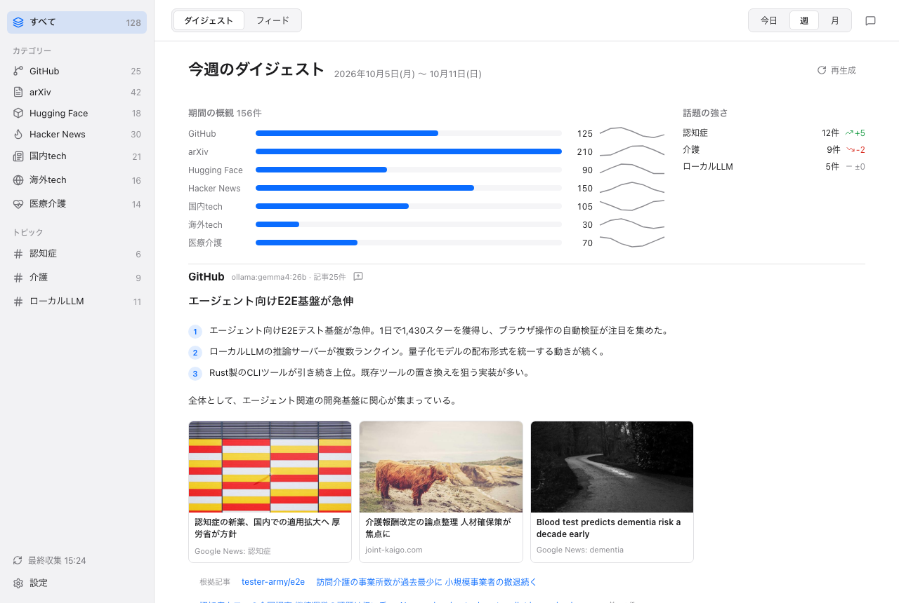

<div align="center">


# InfoDesk

**A local-first desktop reader that collects tech and medical-care news and writes daily, weekly and monthly digests in Japanese.**

InfoDesk fetches articles from RSS feeds, GitHub, Hugging Face, arXiv, Hacker News and Google News,
summarizes the top items with a local LLM (Ollama) or the `claude` CLI, and shows the result as a
digest, a feed and a chat panel. Your data stays in a SQLite file on your Mac.


[](#license)

[Overview](docs/01-overview.md) · [Getting Started](docs/02-getting-started.md) · [Documentation](#documentation) · [CLI](docs/08-cli.md) · [Roadmap](docs/10-roadmap.md) · [日本語](README.ja.md)

<picture>
  <source media="(prefers-color-scheme: dark)" srcset="docs/images/digest-week-dark.png">
  
</picture>

*The weekly digest. The screenshot shows sample data.*

</div>

---

## Why InfoDesk?

- Following tech and medical-care news means opening many sites every day. InfoDesk collects them in one place.
- Reading everything is not realistic. InfoDesk summarizes the top items per category and per topic, by day, week and month.
- Summaries can be written by a model that runs on your own machine. Nothing has to be sent to a cloud service.

## Highlights

- **Collection**: built-in sources (RSS, GitHub, Hugging Face, arXiv, Hacker News, Google News), your own RSS feeds, and topics with keywords. See [Sources and Topics](docs/03-sources-and-topics.md).
- **Japanese digests**: day, week and month digests by category and by topic, with a period overview, a headline, numbered points and image cards. See [Digests](docs/04-digests.md).
- **Feed and reader**: filter by period, source, unread, starred and search; open articles in an in-app reader window or the default browser. See [Feed and Reader](docs/05-feed-and-reader.md).
- **AI chat**: ask questions about collected articles and summaries. The agent runs in a Node sidecar and can use Ollama or the `claude` CLI. See [AI Chat](docs/06-ai-chat.md).
- **Local LLM first**: Ollama is the default provider for item summaries and digests. See [Settings](docs/07-settings.md).
- **CLI**: the `infodesk` command collects, summarizes and prints digests from the terminal. See [CLI](docs/08-cli.md).
- **Privacy**: the page fetch refuses private and local addresses, and the reader window has no access to the app's IPC. See [Privacy and Security](docs/09-privacy-and-security.md).

## Quick Start

Prerequisites: macOS (Apple Silicon is what has been tested), [Rust](https://rustup.rs), Node.js 22+, and either [Ollama](https://ollama.com) with a model pulled or the [`claude` CLI](https://claude.com/claude-code).

```bash
git clone https://github.com/kousuke-takeuchi/InfoDesk.git
cd InfoDesk
cd agent && npm install && npm run build && cd ..
cd app && npm install && npm run tauri dev
```

To use the CLI without the app:

```bash
cargo run -p infodesk -- collect
cargo run -p infodesk -- digest day
```

Full instructions, building the bundle and troubleshooting: **[Getting Started](docs/02-getting-started.md)**.

## Documentation

Read in order. Files are numbered.

| # | Document | What you will learn |
|---|---|---|
| 01 | [Overview](docs/01-overview.md) | What InfoDesk is, who it is for, design goals |
| 02 | [Getting Started](docs/02-getting-started.md) | Prerequisites, run, build, install, troubleshoot |
| 03 | [Sources and Topics](docs/03-sources-and-topics.md) | Built-in sources, RSS, topics, article images, schedule |
| 04 | [Digests](docs/04-digests.md) | Periods, category and topic digests, overview, regenerate |
| 05 | [Feed and Reader](docs/05-feed-and-reader.md) | Feed filters, read and star, in-app reader |
| 06 | [AI Chat](docs/06-ai-chat.md) | Chat panel, providers, tools, progress, web search |
| 07 | [Settings](docs/07-settings.md) | Every setting with its default, menu bar, launch at login |
| 08 | [CLI](docs/08-cli.md) | The `infodesk` commands and the app's `--cli` mode |
| 09 | [Privacy and Security](docs/09-privacy-and-security.md) | What stays local, what goes over the network, isolation |
| 10 | [Roadmap](docs/10-roadmap.md) | What is done, known limits, open ideas |

Each page has a Japanese twin (`*.ja.md`). Developer documentation lives in [`docs/internal/`](docs/internal/README.md) and is written in Japanese. The design spec and implementation plans are under [`docs/superpowers/`](docs/superpowers/).

## Architecture at a glance

```
React UI    →  Tauri commands  →  infodesk-core (collect, store, summarize)  →  SQLite
CLI         →  infodesk-core
Chat panel  →  Node sidecar (127.0.0.1)  →  app binary in --cli mode  →  infodesk-core
```

The `infodesk-core` library does the work, the `infodesk` CLI and the Tauri app are thin front ends over it, and the chat agent is a Node sidecar bound to 127.0.0.1. Details: [internal/architecture.md](docs/internal/architecture.md).

## Status & Roadmap

**Alpha, personal project.** Version 0.1.0, macOS only. The core library, the CLI, the desktop app, the chat agent, article thumbnails and progress display, and the visual digest with the in-app reader are implemented. Known limits and open ideas are in the [roadmap](docs/10-roadmap.md). Built with Tauri 2, React 19 and Rust.

## Contributing

The project follows a spec-first, design-first (`design.pen`), TDD workflow. Read [CONTRIBUTING.md](CONTRIBUTING.md) first. The [code of conduct](CODE_OF_CONDUCT.md) applies to every project space, and [SECURITY.md](SECURITY.md) says how to report a vulnerability. English is canonical for documentation; Japanese versions are provided as `*.ja.md`.

## License

Licensed under either of

- Apache License, Version 2.0 ([LICENSE-APACHE](LICENSE-APACHE) or http://www.apache.org/licenses/LICENSE-2.0)
- MIT license ([LICENSE-MIT](LICENSE-MIT) or http://opensource.org/licenses/MIT)

at your option.

Unless you explicitly state otherwise, any contribution intentionally submitted for inclusion in this work by you, as defined in the Apache-2.0 license, shall be dual licensed as above, without any additional terms or conditions.

### Trademarks

GitHub, Hugging Face, arXiv, Hacker News, Claude, Anthropic and Ollama are names of their respective owners. InfoDesk is not affiliated with, endorsed by, or derived from any of them. These names appear only to describe the sources InfoDesk reads and the tools it can use.
