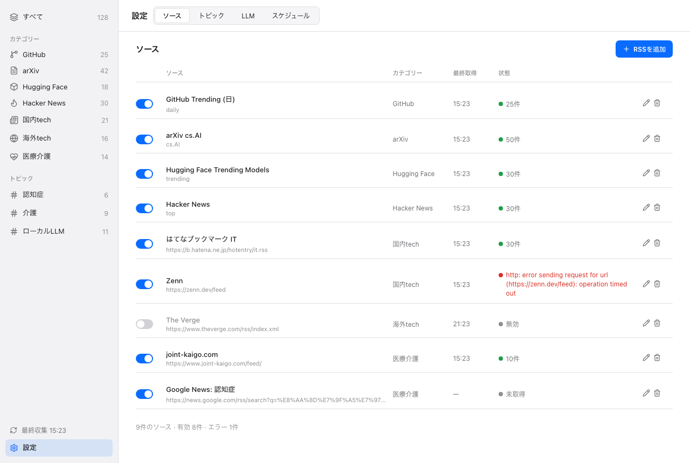
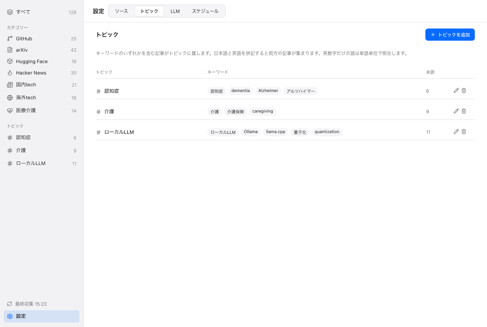

**日本語: [03-sources-and-topics.ja.md](03-sources-and-topics.ja.md)** | ← [Getting Started](02-getting-started.md) | Next: [Digests →](04-digests.md)

# Sources and Topics

A **source** is a place InfoDesk collects articles from. Each source belongs to one of seven fixed **categories**. A **topic** is a named list of keywords that cuts across categories.

## 1. Built-in sources

The first launch adds these sources (checked on 2026-10-06). They are ordinary rows: you can disable, edit or delete any of them.

| Category | Sources | Kind |
|---|---|---|
| GitHub | GitHub Trending (daily, weekly, monthly) | `github_trending` |
| arXiv | cs.AI, cs.CL, cs.LG | `arxiv` |
| Hugging Face | Trending Models, Daily Papers | `hf_models`, `hf_papers` |
| Hacker News | Top stories | `hackernews` |
| Japan tech (国内tech) | Hatena Bookmark IT, Publickey, ITmedia, Zenn | `rss` |
| International tech (海外tech) | TechCrunch, The Verge, Ars Technica, MIT Technology Review | `rss` |
| Healthcare and care (医療介護) | joint-kaigo.com, care-news.jp, Google News searches for 認知症, 介護 and dementia | `rss` |

The category ids used by the CLI and the database are `github`, `arxiv`, `huggingface`, `hackernews`, `tech_jp`, `tech_intl` and `medcare`.

## 2. Managing sources

Open **Settings** and choose the **Sources** tab.

<picture>
  
</picture>

*The Sources tab (sample data).*

- Use the toggle to enable or disable a source. Disabled sources are not collected.
- Press the pencil to edit the display name and the category. The config value (for an RSS source, the feed URL) is shown but cannot be changed. To change the URL of an RSS source, delete it and add it again.
- Press the trash can to delete a source. Articles already collected are kept.
- Each row shows the last fetch time and a status (item count, error, or disabled).

### Adding an RSS feed

1. Press **Add RSS** (RSSを追加).
2. Enter the feed URL, a display name (optional) and a category.
3. Press **Add**. InfoDesk fetches the feed once to check it, and saves the source only when the feed parses as RSS or Atom. Otherwise the dialog shows the error and nothing is saved. If the display name is empty, the feed title is used.

An added feed behaves like a built-in one: it can be toggled, edited, collected and summarized.

From the command line: `infodesk source add-rss <URL> --category tech_jp`.

## 3. Topics

A topic has a name and keywords, for example the name 認知症 with the keywords 認知症, dementia, Alzheimer.

<picture>
  
</picture>

*The Topics tab (sample data).*

- Open the **Topics** tab, press **Add topic**, enter a name and comma-separated keywords.
- An article belongs to a topic when its title or excerpt matches any keyword.
- Keywords made only of letters and digits (such as `AI` or `Rust`) match whole words only, case-insensitively. `AI` does not match "again". Other keywords match as substrings, and words of two characters or fewer are matched too.
- Matching happens when you search, so a new or changed topic applies to articles you have already collected.
- Topics appear in the sidebar with unread counts. Selecting one narrows both the feed and the digest to that topic.
- Changing the keywords or deleting a topic removes that topic's saved digests.

CLI example: `infodesk topic add 認知症 認知症 dementia Alzheimer`.

## 4. Article images

For each new article, InfoDesk decides an image URL once, at collection time, and stores it. Articles without an image stay without one, and older articles are not backfilled. The thumbnail is shown in the [feed](05-feed-and-reader.md) and as a card in [digests](04-digests.md).

The image is chosen in this order:

1. **RSS and Atom**: the media thumbnail, a media content image, or an image enclosure in the entry.
2. **GitHub Trending**: the avatar of the repository owner (`https://github.com/<owner>.png`). No extra request is made.
3. **Page fetch**: if there is still no image, InfoDesk fetches the article page and reads `og:image` (or `twitter:image` if there is none).

Articles from arXiv and from Google News redirect URLs (`news.google.com`) are never fetched and get no image.

The page fetch has these limits:

| Limit | Value |
|---|---|
| Concurrent fetches | 4 |
| Per page timeout | 10 seconds |
| Bytes read per page | the first 512 KB |
| Time budget per collection | 60 seconds (pages not finished by then are skipped) |
| Redirects followed | up to 5 |
| Addresses | private, loopback and local addresses are refused |
| Image URL | `https` only, no user info, at most 2048 characters; relative URLs are resolved against the page URL |

A failed fetch never blocks saving the article and is not recorded as a collection error. Because of the page fetch, collection contacts the sites of new articles from your Mac. Images are loaded from the original site each time they are shown. See the privacy page for details.

## 5. Collection schedule

Collection runs on a timer and on demand.

- **Interval**: every 3 hours by default. The Schedule tab offers 1, 3, 6 or 12 hours (`schedule.collect_interval_hours`).
- **Collect now**: from the feed's empty state, the Schedule tab or the menu bar.
- **After each collection**: the top articles of each category get a summary (20 per category by default, `summary.top_n`), and today's daily digest is rebuilt.
- **Daily digest**: the previous day is finalized at 07:00 (`schedule.daily_time`).
- **Weekly digest**: the previous week is generated on Monday at 07:30 (`schedule.weekly_day`, `schedule.weekly_time`).
- **Monthly digest**: the previous month is generated on the 1st at 08:00 (`schedule.monthly_time`).

Scheduled jobs that did not run (the Mac was asleep or the app was closed) are made up once, the next time the app starts or wakes. All times are your local time.
