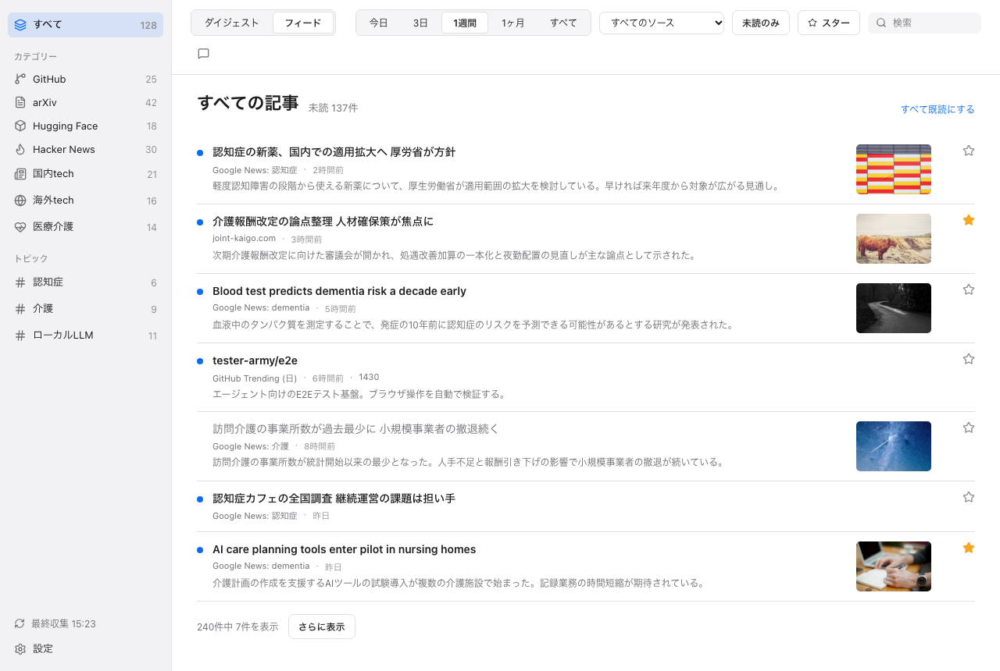

**English: [05-feed-and-reader.md](05-feed-and-reader.md)** | ← [ダイジェスト](04-digests.ja.md) | 次: [AI チャット →](06-ai-chat.ja.md)

# フィードと閲覧ウィンドウ

## 1. フィード

ツールバーの**フィード**の切替で、集めた記事を新しい順に一覧します。

<picture>
  
</picture>

*フィード (サンプルデータ)。*

各行に出るもの:

- 未読の記事には青い点 (タイトルも太字)
- タイトル、ソース名、相対時刻、ソースに指標があればそのスコア (スター数、ポイントなど)
- 日本語の記事要約 (要約を付けた上位の記事のみ)
- 画像のある記事は右端にサムネイル ([ソースとトピック](03-sources-and-topics.ja.md#4-記事の画像)を参照)
- その記事についてチャットで質問するボタン
- スターのボタン

見出しには未読件数と**すべて既読にする**のリンクが出ます。このリンクは、データベース全体ではなく、今の絞り込みに対して働きます。

### 絞り込み

サイドバーの選択 (すべて、カテゴリー、トピック) が範囲を決めます。ツールバーで次を足せます。

| 絞り込み | 選択肢 |
|---|---|
| 期間 | 今日、3日、1週間、1ヶ月、すべて。今日の0時から数えた日数で、暦の週ではありません |
| ソース | すべてのソース、または1つのソース |
| 未読のみ | 切替 |
| スター | 切替 |
| 検索 | フリーワード。タイトルと抜粋に対して照合 |

一覧は100件ずつ読み込みます。それ以上あるときは**さらに表示**を押します。下に総数のうち何件を表示中かが出ます。

まだ何も収集していないときは、**今すぐ収集**と**ソースを確認**のボタンがある空の画面になります。

### 既読とスター

- 記事を開くと既読になります。
- スターのボタンで、スターを付けたり外したりします。**スター**の絞り込みで一覧できます。
- サイドバーの件数は、既読、スター、収集のたびに更新されます。

## 2. 閲覧ウィンドウ

記事とリンクは、既定のブラウザーではなく、アプリ内の閲覧ウィンドウで開きます。記事をどこから開いても同じです。フィード (タイトルかサムネイル)、ダイジェストの根拠記事と画像カード、チャットの回答内のリンクが対象です。

閲覧ウィンドウは1つを使い回します。別の記事を開くと、同じウィンドウで移動して前面に出ます。上にツールバー、その下に記事のページがあります。

| ツールバーの操作 | 動作 |
|---|---|
| 戻る、進む | ページの履歴を移動する |
| 再読み込み | ページを読み込み直す |
| ページのタイトルと URL | 表示中のページを示す |
| ブラウザで開く | 表示中のページを既定のブラウザーに渡す |
| 閉じる | 閲覧ウィンドウを閉じる |

何をどこで開くかの規則:

- 開けるのは `http` と `https` のアドレスだけです。閲覧ウィンドウの中での移動でも、それ以外のスキームは止めます。
- 新しい窓を開くリンク (`target="_blank"`) は、同じ閲覧ウィンドウで開きます。
- 自分のマシンや手元のネットワーク (localhost、ループバック、プライベート、リンクローカルの範囲) を指すアドレスは、閲覧ウィンドウでは読み込みません。そのアドレスの記事は既定のブラウザーで開きます。チャットの回答の中のそのようなリンクは開きません。
- 記事のページには、アプリ内部のコマンドを呼ぶ権限を与えません。分離の詳細はプライバシーのページを参照してください。

記事についてチャットで質問するには、その行のチャットのボタンを押します。[AI チャット](06-ai-chat.ja.md)を参照してください。
