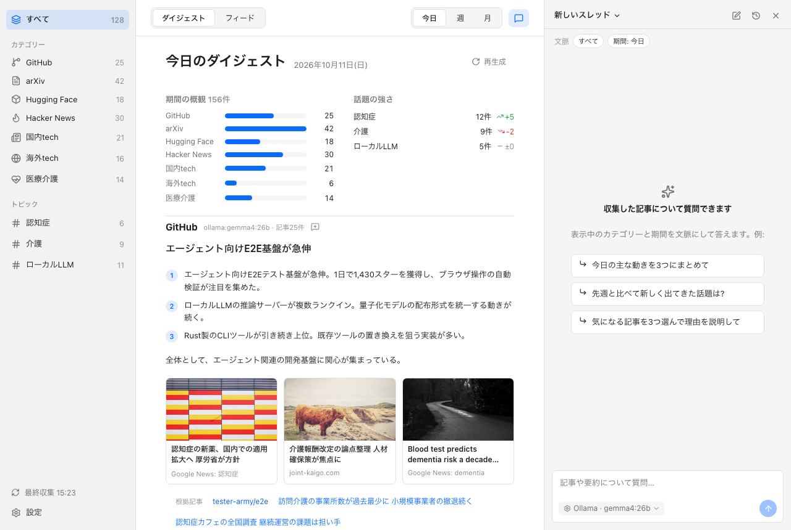

**English: [06-ai-chat.md](06-ai-chat.md)** | ← [前: フィードと閲覧](05-feed-and-reader.ja.md) | 次: [設定 →](07-settings.ja.md)

# AI チャット

チャットパネルでは、InfoDesk が集めた記事と要約についてエージェントに質問できます。エージェントは日本語で答え、いくつかのツールでデータを読み、その作業の様子を表示します。

*ダイジェストの横にチャットパネルを開いたところ。モックしたバックエンドのサンプルデータです。*

## チャットを開く

- ツールバーのチャットボタンでパネルを開閉します。ダイジェストとフィードの右側に出ます。
- 設定を開いているあいだ、パネルは隠れるだけで残ります。回答の途中やスレッドは失われません。
- エージェントを起動できないとき (たとえば Node がない) は、パネルに原因と LLM 設定を開くボタンが出ます。ダイジェストとフィードは使えます。

## スレッド

- 会話はスレッドとして扱います。タイトルは最初の質問の先頭30文字です。
- スレッドは最初の回答が終わったときに作って保存します。空のスレッドは残りません。
- 新規スレッドのボタンで新しい会話を始めます。履歴ボタンで保存済みのスレッドの一覧、切替、削除ができます (削除は確認つき)。
- スレッドはアプリの DB (`chat_threads` と `chat_messages` テーブル) に保存します。

## 文脈のチップ

ヘッダーの下に、質問の対象がチップで出ます。

- 表示中の範囲: すべての記事、カテゴリー、トピックのいずれか。
- 期間: ダイジェストの期間 (今日、今週、今月) またはフィードの期間。
- 添付した項目: フィードの行やダイジェストの項目にある「チャットで質問」ボタンで、その記事や要約を文脈に加えます。添付したチップには外すボタンがあります。

この文脈は質問のたびにエージェントへ渡されます。添付した記事は `get_article` ツールで読みます。

## プロバイダー

| プロバイダー | 動き方 | 備考 |
|---|---|---|
| Ollama | エージェントが `ollama.base_url` の Ollama サーバーを `ollama.model` で呼びます (既定は `http://localhost:11434` と `gemma4:26b`)。文脈長は 16384 です。 | Ollama の起動とモデルの取得が必要です。 |
| Claude | エージェントが `claude` CLI (`claude.bin`) をモデル別名 `sonnet` で実行します。セッションはディスクに残しません。 | CLI にログインが必要です。ツールは MCP サーバーとして渡します。 |

- 既定のプロバイダーは `llm.chat_provider` (既定は `ollama`) です。パネルの入力欄にある選択で、そのパネルのプロバイダーを切り替えられます。設定の値は変わりません。
- 自動のフォールバックはありません。失敗したときは、エラー欄に再試行、もう一方のプロバイダーで同じ質問を送るボタン、LLM 設定へのボタンが出ます。質問は入力欄に残ります。
- エラーは種類ごとに表示します。Ollama に接続できない、モデルがない (`ollama pull` のコマンド付き)、Claude にログインしていない、`infodesk` CLI を実行できない、その他。

## ツール

エージェントは、JSON 出力の `infodesk` CLI ([CLI](08-cli.ja.md) を参照) でデータを読みます。データは書き換えません。

| ツール | 内容 |
|---|---|
| `search_articles` | 収集済みの記事を、キーワード、カテゴリー、トピック、日数、日付の範囲で検索します。新しい順。最大50件 (既定20件)。 |
| `get_article` | 記事1件の概要、記事要約、URL を読みます。 |
| `read_digests` | 生成済みの日次、週次、月次の要約を読みます。生成はしません。カテゴリーとトピックはどちらか一方だけ指定します。 |
| `fetch_page` | 記事の URL を取得して本文のテキストを返します。保存しません。最大20000文字。Ollama では文脈に収めるため既定が6000文字です。 |
| `update_plan` | 1〜8項目の作業計画を示します。ツールを2回以上使う質問で使います。 |
| Web 検索 | 収集した記事の外を検索します。下を参照。 |

### Web 検索

- Claude は組み込みの WebSearch を使います。
- Ollama は ollama.com の Web 検索 API を使います。設定の LLM タブで「Web検索 APIキー」(`ollama.web_search_api_key`) を入れたときだけ有効です。未設定ならツールを渡しません。結果は既定5件、最大10件です。
- Web 検索は質問の語を外部サービスへ送ります。[プライバシーとセキュリティ](09-privacy-and-security.ja.md)を参照してください。

## 途中経過の表示

回答は、実行中は作業の様子を出し、終わると1行にたたみます。

- 実行中の状態行: 「調査中 · 12秒 · ツール3回」。1秒ごとに更新します。
- モデルが計画を出したときは、作業計画のチェックリスト。回答が正常に終わると全項目が完了の表示になります。
- モデルが思考を返したときは、「考え中…」の折りたたみ (思考の全文)。
- ツール呼び出しごとの行。押すと入力と結果の要点が開きます (たとえば見つかった記事のタイトル、ページのタイトルと本文の冒頭)。失敗したツールはエラー文を出します。
- 回答が終わると、作業は「4ステップ · 18秒」のような1行にたたまれます。ステップ数は思考とツール呼び出しの数で、計画の更新は含みません。押すと開きます。
- 書き終えずに止まった回答 (ステップの上限、エラー、中断) には「途中で停止」と出て、計画は最後の状態のままです。
- ツールが返した記事は、回答の下にリンクで並びます (最大8件)。押すとその記事を開きます。

1回の回答の上限は、Ollama が20ステップ、Claude が20ターンです。

## 回答の中のリンクと画像

- 回答の中のリンクは、アプリ内の閲覧ウィンドウで開きます。開くのは http と https だけです。
- 回答の中の画像は読み込みません。代替テキストだけを出します。回答を表示するだけで外部サーバーへ要求が出ないようにするためです。

## プロンプトインジェクション

エージェントは、他人が書いた記事や Web ページの文章を読みます。その文章にモデルへの指示が紛れていることがあります。InfoDesk は被害を小さくしますが、リスクをなくすことはできません。

- ツールは読み取り専用です。DB へ書く、コマンドを実行する、手元のファイルを読むツールはありません。
- `fetch_page` はローカルとプライベートのアドレスを拒みます ([プライバシーとセキュリティ](09-privacy-and-security.ja.md)を参照)。
- システムプロンプトで、ツールで確かめた内容だけを書くよう指示しています。

回答は読む助けとして扱ってください。何かを判断する前に、リンク先の元記事を確かめてください。

## 関連ページ

- [設定](07-settings.ja.md): `llm.chat_provider`、Ollama、Claude と Node のパス、Web 検索キー。
- [ダイジェスト](04-digests.ja.md): チャットが読める期間。
