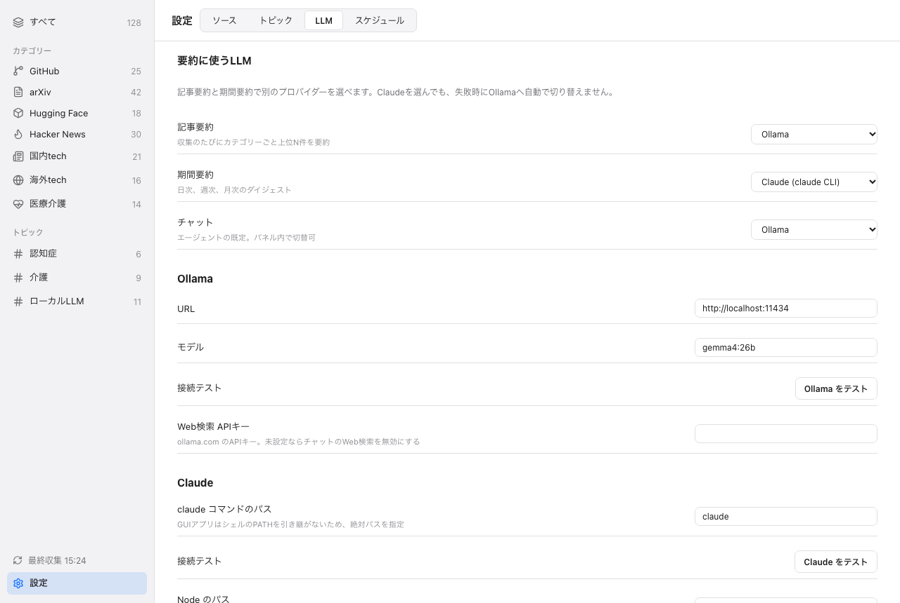
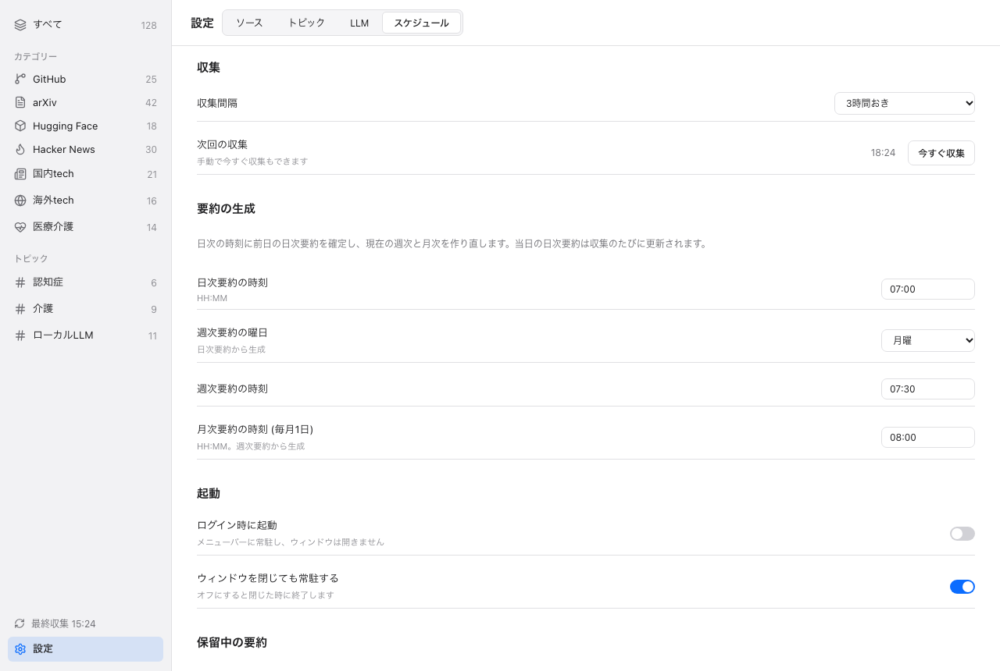

**日本語: [07-settings.ja.md](07-settings.ja.md)** | ← [AI Chat](06-ai-chat.md) | Next: [CLI →](08-cli.md)

# Settings

Open Settings from the sidebar, or from the menu bar item "設定…" (Cmd+,). Settings has four tabs: Sources, Topics, LLM and Schedule. Changes are saved when you edit a field.

## Tabs

| Tab | What it holds |
|---|---|
| Sources | Turn built-in sources on or off, add RSS feeds. See [Sources and Topics](03-sources-and-topics.md). |
| Topics | Topics and their keywords. See [Sources and Topics](03-sources-and-topics.md). |
| LLM | Which LLM each job uses, the Ollama and Claude settings, the Node path, connection tests. |
| Schedule | Collection interval, digest times, launch behavior, retry of pending digests. |

### LLM tab

*The LLM tab. Sample data from a mocked backend.*

- "要約に使うLLM": choose Ollama or Claude (claude CLI) separately for article summaries, period digests and chat. Choosing Claude does not fall back to Ollama when it fails.
- "Ollama": the URL, the model, a connection test, and the web search API key for chat.
- "Claude": the path of the `claude` command, a connection test, and the path of Node (used to run the chat agent).
- The path fields accept a bare command name (letters, digits, `_`, `.`, `-`) or an absolute path to an existing file. A GUI app does not inherit your shell PATH, so an absolute path is the safe choice.

### Schedule tab

*The Schedule tab. Sample data from a mocked backend.*

- "収集": the collection interval (1, 3, 6 or 12 hours in the menu), the next collection time, and a "collect now" button.
- "要約の生成": the daily time, the weekly day and time, and the monthly time (on the 1st). At the daily time the previous day's digest is finalized and the current week and month are rebuilt. Today's daily digest is refreshed after every collection.
- "起動": launch at login and stay resident.
- "保留中の要約": the last error, and a button to retry digests that are pending or failed. Pending digests are also retried at each scheduled run.

A job that did not run (the Mac was asleep, or the app was closed) is made up once at the next start or wake.

## Settings keys

All settings are stored in the app database as text. Defaults are written on first launch. A missing key falls back to its default.

| Key | Default | Meaning |
|---|---|---|
| `llm.items_provider` | `ollama` | Provider for article summaries. `ollama` or `claude`. |
| `llm.digest_provider` | `ollama` | Provider for day, week and month digests. `ollama` or `claude`. |
| `llm.chat_provider` | `ollama` | Default provider for chat. `ollama` or `claude`. The chat panel can switch per panel. |
| `ollama.base_url` | `http://localhost:11434` | Ollama server URL. |
| `ollama.model` | `gemma4:26b` | Ollama model name. |
| `ollama.web_search_api_key` | empty | ollama.com API key. Enables web search in chat when the provider is Ollama. |
| `claude.bin` | `claude` | Command or absolute path of the Claude CLI. |
| `node.bin` | `node` | Command or absolute path of Node (22 or newer) for the chat agent. |
| `summary.top_n` | `20` | How many top articles per category get an article summary after each collection. Not shown in Settings. Must be a number. |
| `schedule.collect_interval_hours` | `3` | Hours between collections. Values outside 1 to 168 are clamped. An invalid value falls back to 3. |
| `schedule.daily_time` | `07:00` | Time (HH:MM) to finalize the previous day's digest. |
| `schedule.weekly_day` | `mon` | Day of the weekly digest: `mon`, `tue`, `wed`, `thu`, `fri`, `sat` or `sun`. |
| `schedule.weekly_time` | `07:30` | Time (HH:MM) of the weekly digest. |
| `schedule.monthly_time` | `08:00` | Time (HH:MM) of the monthly digest, on the 1st of the month. |
| `app.launch_at_login` | `false` | Start InfoDesk at login, in the menu bar without opening a window. |
| `app.stay_resident` | `true` | Keep running in the menu bar when the main window is closed. |

An invalid time or weekday value is ignored and the default is used.

The scheduler also keeps its own bookkeeping keys: `schedule.last_collect_at`, `schedule.last_daily_for`, `schedule.last_weekly_for` and `schedule.last_monthly_for`. They record what already ran. Do not edit them.

The app only accepts the keys above. Setting `app.launch_at_login` is done with the toggle, because it also registers the login item. With the [CLI](08-cli.md), `config set` writes any key without checking it, so type carefully.

## Menu bar

InfoDesk puts an icon in the macOS menu bar. Clicking it opens this menu:

- A status line: the last collection time ("最終収集 HH:MM"), "収集中…" while collecting, or "未収集".
- An unread count and the state of today's digest, for example "未読 12件 · 日次要約 生成済み".
- "今すぐ収集": collect now.
- "ウィンドウを開く" (Cmd+O): show the main window.
- "設定…" (Cmd+,): open Settings.
- "InfoDesk を終了" (Cmd+Q): quit.

## Stay resident and launch at login

- **Stay resident** (`app.stay_resident`, on by default): closing the main window hides it. Collection and digest jobs keep running in the menu bar. Turn it off to quit when the window closes. The reader window always closes normally.
- **Launch at login** (`app.launch_at_login`, off by default): starts InfoDesk when you log in, in the menu bar, with no window. It uses the macOS login item.
- To quit completely, use "InfoDesk を終了" in the menu bar.
