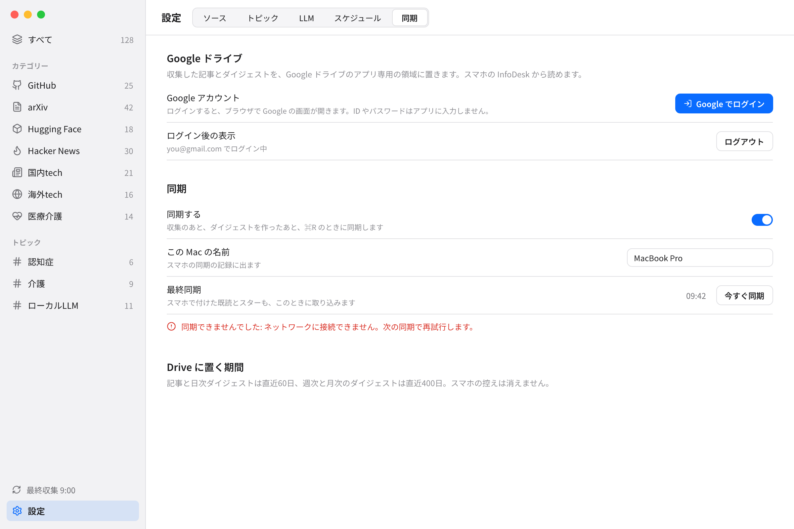

**English: [12-cloud-sync.md](12-cloud-sync.md)** | ← [前: キーボードショートカット](11-keyboard-shortcuts.ja.md)

# クラウド同期

InfoDesk は、収集した内容を利用者本人の Google ドライブに置き、スマホのアプリから読めるようにできます。このページでは、同期の働き、使い方、ビルドの前に開発者が1回だけ行う Google 側の準備、Drive に置くファイル、困ったときの対処を説明します。

モバイルアプリ自体は、このリリースには含まれません。このリリースは Mac 側だけです。

## 1. 何をするか

- Mac はこれまでどおり記事を収集し、ダイジェストを作ります。そのあと、Google ドライブのアプリ専用の隠れた領域に書き出します。
- スマホはそのファイルを読みます。記事とダイジェストは書き換えません。
- 既読とスターは双方向です。スマホで付けた印は Mac に、Mac で付けた印はスマホに届きます。同じ記事を2台で変えたときは、新しい変更が勝ちます。
- Drive 上の各ファイルの書き手は1台だけなので、端末どうしが上書きし合うことはありません。
- ネットワークが切れても、Mac は単独で動き、つながったあとの同期で追いつきます。

## 2. 使い方

1. 設定 (Cmd+,) を開き、「同期」タブを選びます。
2. 「Google でログイン」を押します。ブラウザで Google の画面が開くので、ログインして許可します。ID やパスワードを InfoDesk に入力することはありません。ブラウザに「ログインしました」と出たら InfoDesk に戻ります。
3. タブにアカウントが表示されます。「同期する」がオフならオンにします (初期値はオフ)。
4. 「今すぐ同期」を押すと、すぐ同期します。

そのあとは、次のときに自動で同期します。

- 収集のあと (収集を行う Cmd+R も含む)
- ダイジェストを作ったあと
- 「今すぐ同期」を押したとき

同期は同時に1回だけ走ります。タブには最終同期の時刻と、別の行に同期のエラーが出ます。同期のエラーが収集やダイジェストに影響することはありません。この Mac の名前 (初期値はコンピューター名) も変えられます。同期の記録に出ます。

「ログアウト」は、Google 側でアクセスを失効させ、macOS のキーチェーンからトークンを消します。



このビルドに Google の認証情報がないとき (3節) は、タブに「このビルドでは同期を使えません」と出て、ログインのボタンは出ません。

## 3. 開発者向け: Google 側の準備

できあがったビルドを使う人は、この節を飛ばせます。自分で InfoDesk をビルドするときに、1回だけ行います。OAuth のクライアント ID とシークレットはリポジトリに入っていないので、それらがないビルドでは同期が無効になります。

Cloud Console の画面は変わることがあるので、この手順では画面の名前を大まかに書きます。表示が違うときは、近い項目を探してください。

1. **プロジェクトを作る。** 個人の Google アカウントで Google Cloud Console にログインし、新しいプロジェクト (例: 「InfoDesk」) を作ります。
2. **Google Drive API を有効にする。** プロジェクトで「API とサービス」を開き、ライブラリから「Google Drive API」を探して有効にします。
3. **OAuth 同意画面を設定する。** 「API とサービス」の OAuth 同意画面を開きます (Google が「Google Auth Platform」にまとめていることもあります)。
   - 対象 (ユーザーの種類): 外部。
   - スコープ: Drive のスコープは `https://www.googleapis.com/auth/drive.appdata` だけを入れます。ほかの Drive のスコープや sensitive なスコープは入れません。(アプリは本人のアドレスを表示するためだけに、基本の `openid` と `email` も要求します。)
   - 公開状態を「本番」(In production) にします。
4. **OAuth クライアントを作る。** 「API とサービス > 認証情報」で、アプリケーションの種類を「デスクトップ アプリ」にして OAuth クライアント ID を作ります。クライアント ID とクライアント シークレットを控えます。
5. **値をビルドに渡す。** `app/src-tauri/google-oauth.example.json` を `app/src-tauri/google-oauth.json` にコピーし、2つの値を書きます。

   ```json
   {
     "client_id": "YOUR_CLIENT_ID.apps.googleusercontent.com",
     "client_secret": "YOUR_CLIENT_SECRET"
   }
   ```

   コンソールでダウンロードできる JSON ファイル (値が `"installed"` の下にある形) を、そのまま `app/src-tauri/google-oauth.json` として置いてもかまいません。

6. **ビルドし直す。** (`cd app && npm run bundle`、[はじめに](02-getting-started.ja.md)を参照。または `npm run tauri dev`。) 値はビルド時に読み込まれ、アプリに埋め込まれます。ファイルを書き換えたらビルドし直します。

補足:

- **「本番」にする理由。** 公開状態が「テスト」のあいだ、Google は更新用トークンを7日で失効させます。毎週ログインし直すことになります。「本番」にすれば避けられます。
- **審査は不要。** `drive.appdata` は non-sensitive (機微でない) スコープなので、Google のアプリ審査は要りません。
- **ファイルは git 管理外。** `app/src-tauri/google-oauth.json` は `.gitignore` に入っています。コミットしないでください。デスクトップアプリのクライアント シークレットは、Google の扱いでは秘密とみなされませんが、公開リポジトリには置きません。
- **ファイルがない、または壊れている**と、同期は無効になります。JSON として読めないファイルは、ビルド時に警告も出します。
- 将来のモバイル用クライアント (iOS の OAuth クライアント) も、同じ Google Cloud プロジェクトで作る想定です。アプリ専用の Drive 領域はプロジェクト単位で共有されるためです。

## 4. Drive に置くファイルと保持期間

InfoDesk は Drive の隠れたアプリ専用領域 (`appDataFolder`) を使います。通常の Drive のファイル一覧には出ません。InfoDesk が隠しデータを持っていることは、Google アカウントの Drive の設定にある「アプリの管理」で確認できます。

| ファイル | 書き手 | 内容 |
|---|---|---|
| `manifest.json` | Mac | 形式の版、DB の識別子、各ファイルの名前とハッシュと更新時刻、最終書き出し時刻 |
| `meta.json.gz` | Mac | カテゴリー、トピック、ソース |
| `day-YYYY-MM-DD.json.gz` | Mac | その日に収集した記事 (タイトル、抜粋、AI 要約、画像 URL、ソース、カテゴリー、スコア、時刻、当たるトピックの id) |
| `digest-{day,week,month}-YYYY-MM-DD.json.gz` | Mac | ダイジェストと、その期間の概観 |
| `state-snapshot.json.gz` | Mac | 既読とスターの確定状態。1日に1回ほどまとめる |
| `ops-<端末ID>-<時刻>-<連番>.json` | 各端末 | 既読とスターの変更の束。一度書いたら変えない |

既読とスターは、記事のファイルには入れません。記事の画像は Drive に置かず、スマホが元のサイトから読みます。

保持期間:

- 記事と日次ダイジェスト: 直近60日 (Mac の日付)。古い `day-*` と `digest-day-*` は Mac が消します。
- 週次と月次のダイジェスト: 直近400日。
- 1日に1回、Mac は全端末の変更の束を `state-snapshot.json.gz` にまとめ、まとめた束を消します。Mac 側の送信済みの変更記録も、30日より古いものは消します。
- 初回の同期と、「同期する」をもう一度オンにした後の最初の同期では、必ず `state-snapshot.json.gz` を書きます。同期ができる前や、同期がオフの間に付けた既読とスターも、これで届きます。同期がオフの間、Mac は印の時刻だけを残し、送るための変更の記録は作りません。
- スマホの控えは、利用者がスマホの設定から消すまで残ります。

Mac の DB を作り直すと、記事の id が変わります。次の同期で Mac は `manifest.json` の古い DB の識別子に気づき、変更の束と古い `state-snapshot.json.gz` を、取り込まずにすべて消します (それらの記事 id は別の記事を指すため)。そのうえで新しい DB を書き出します。Mac がまだ取り込んでいなかったスマホの印は失われます。`manifest.json` の DB の識別子が変わったことで、スマホは控えを捨てて取り直します。

## 5. 困ったとき

- **「Google の再ログインが必要です」と出る。** 保存してあるトークンが使えなくなっています (Google アカウント側でアクセスを取り消した、パスワードを変えた、トークンの期限切れなど)。同期は止まります。「ログアウト」が出ていれば押してから、もう一度「Google でログイン」します。
- **ログインが終わらない。** Google は結果をこの Mac の `http://127.0.0.1` に返すので、ブラウザがそこへ届く必要があります。ログインは5分待って、あきらめます。もう一度ボタンを押してください。
- **Drive の容量がいっぱい。** Mac が置くファイルは小さい (圧縮した JSON) ですが、アプリ専用の領域も Drive の容量に数えられます。Google が容量のエラーを返すと、同期は失敗してエラーが出ます。Google アカウントの容量を空けて、「今すぐ同期」を押します。
- **レート制限とネットワークのエラー。** ネットワークのエラー、HTTP 429、5xx、Drive のレート制限は、その回の同期をやめます。次の同期でやり直すので、失われるものはありません。同期タブの同期の行に「ネットワークに接続できません。次の同期で再試行します。」と出ます。
- **「このビルドでは同期を使えません」と出る。** ビルドに `google-oauth.json` がありません。3節を見てください。
- **スマホの印が Mac に出ない。** 印は同期のたびに取り込みます。Mac で「今すぐ同期」を押します。
- 同期をやめるには、「同期する」をオフにするか、「ログアウト」を押します。Drive にあるファイルは、Drive の「アプリの管理」から消すまで残ります。

設定キーは[設定](07-settings.ja.md)、Google に送られるものは[プライバシーとセキュリティ](09-privacy-and-security.ja.md)を参照してください。
