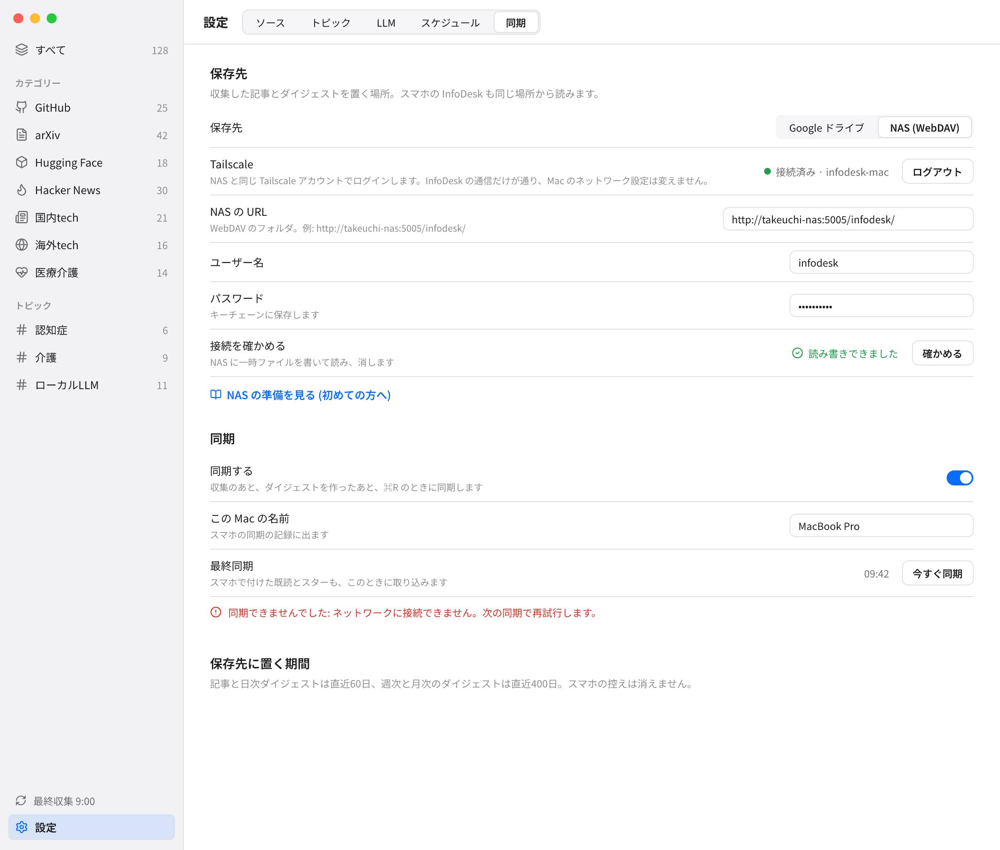
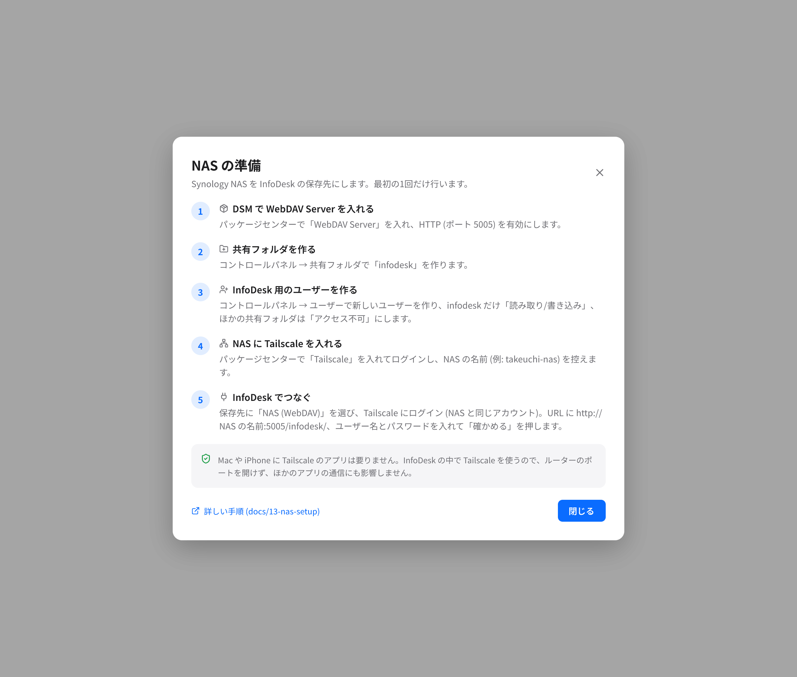

**日本語: [13-nas-setup.ja.md](13-nas-setup.ja.md)** | ← [Cloud Sync](12-cloud-sync.md)

# NAS Setup (Synology WebDAV over Tailscale)

InfoDesk can sync to a Synology NAS you own instead of Google Drive. The Mac reaches the NAS through a Tailscale node that lives inside InfoDesk. This page walks through the one-time setup, how to approve or remove the device in the Tailscale admin console, what each message in the Sync tab means, and what to do when you build the app yourself.

For what sync does and the file layout, see [Cloud Sync](12-cloud-sync.md). The files written to the NAS are the same as those written to Drive.

## 1. How it works

- The NAS is reached only through the Tailscale node inside InfoDesk. There is no system VPN, and you do not need the Tailscale app on the Mac. Other apps on the Mac are not affected, and you open no router ports.
- The node appears as `infodesk-mac` in the Tailscale admin console (the Machines list). It must log in to the same Tailscale account (tailnet) as the NAS.
- The WebDAV address has the form `http://<NAS name>:5005/<folder>/`, for example `http://takeuchi-nas:5005/infodesk/`. It uses HTTP Basic authentication. The traffic to the NAS is carried inside Tailscale's WireGuard tunnel, so plain HTTP on the NAS side is not sent in the clear over the network.
- InfoDesk sends sync data only to a device in your tailnet. Before each sync and each "確かめる", it asks the in-app node for the list of devices in the tailnet and accepts the URL's host only when it is one of them: the device's short name (`takeuchi-nas`), its full Tailscale name (`takeuchi-nas.tail1234.ts.net`, with or without the final dot), its host name, or one of its Tailscale IP addresses (`100.x.y.z`). InfoDesk then connects to that device's Tailscale IPv4 address, with the same port and path. Any other host, such as a LAN address (`192.168.1.10`) or a name outside the tailnet, is refused with 「NAS が Tailscale の中に見つかりません。NAS の名前を確かめてください」, and nothing is sent.
- Because the connection goes to the Tailscale IP address, use `http://`. An `https://` certificate made for the NAS name does not match the address.
- InfoDesk reads, lists and deletes only its own sync files in the folder (`manifest.json`, `meta.json.gz`, `day-*.json.gz` and the others in [Cloud Sync](12-cloud-sync.md)). Other files there, such as `.DS_Store` or your own files, are left alone.
- The Tailscale login page opens only when you press "Tailscale にログイン". At launch, and when you turn on sync or choose NAS, InfoDesk starts the node in the background only if this Mac has logged in before (the `tailscale/` folder holds its state). Otherwise the node stays stopped and the Sync tab asks you to log in.
- The password is stored in the macOS Keychain (service `jp.infodesk.app.nas`), not in the database.
- The Tailscale state (the node key) is saved in the `tailscale/` folder under the app data directory (`~/Library/Application Support/jp.infodesk.app/`) with mode 0700.

## 2. The five steps

The in-app dialog "NAS の準備" shows the same five steps. Screen names in DSM (Synology's NAS software) differ a little between versions, so look for the matching item if a label differs.

1. **Install WebDAV Server on the NAS.** In Package Center, install "WebDAV Server". Open it and turn on HTTP with port 5005. HTTPS is not needed, because Tailscale already encrypts the path.
2. **Create a shared folder.** In Control Panel, open Shared Folder and create one named `infodesk`. InfoDesk writes its files into this folder.
3. **Create a user for InfoDesk.** In Control Panel, open User and create a new user. Give it "Read/Write" on `infodesk` only, and "No access" on every other shared folder. Choose a password you do not use elsewhere.
4. **Install Tailscale on the NAS.** In Package Center, install "Tailscale" and sign in. Note the NAS name shown in the Tailscale admin console (for example `takeuchi-nas`).
5. **Connect from InfoDesk.**
   1. Open Settings (Cmd+,), select the "同期" (Sync) tab, and choose "NAS (WebDAV)" as the storage.
   2. Press "Tailscale にログイン". Your browser opens a Tailscale page. Sign in with the same account as the NAS and allow the device.
   3. Enter the URL (`http://<NAS name>:5005/infodesk/`), the user name and the password.
   4. Press "確かめる". InfoDesk writes a temporary file to the NAS, reads it back and deletes it. When it shows "読み書きできました", turn on "同期する".

Tip: you need no Tailscale app on the Mac or an iPhone for this. InfoDesk uses Tailscale inside the app.

## 3. Approve or remove the device in the Tailscale admin console

Open the Tailscale admin console in a browser and go to the Machines page.

- **Approve.** If your tailnet has device approval turned on, a new device waits for an admin. Find `infodesk-mac`, open its menu and choose to approve it. Until then the Sync tab shows 「Tailscale の管理画面でこの端末を承認してください」.
- **Check.** A running node shows `infodesk-mac` as connected.
- **Remove.** To remove the device, open its menu in the Machines list and choose to delete it. The Mac then has to log in again. Pressing "ログアウト" in the Sync tab also removes the device, because logout is sent to Tailscale first.
- **Key expiry.** A device key can expire after a set time. If it does, log in again from the Sync tab, or turn off key expiry for `infodesk-mac` in the admin console.

## 4. Switching the storage

Switching between Google Drive and NAS does a full re-publish to the new storage on the next sync. The old storage keeps its files; InfoDesk does not delete them. Remove them yourself when you no longer need them (the `infodesk` folder on the NAS, or the app data in Google's "Manage apps" settings).

## 5. Troubleshooting

The Sync tab shows these messages as the last sync error or as the result of "確かめる".

| Message | Meaning and fix |
|---|---|
| 「NAS のユーザー名かパスワードが違います」 | The NAS answered 401. Re-enter the user name and password in the Sync tab. Check that the DSM user exists and has access to the shared folder. |
| 「Tailscale にログインしてください」 | The in-app node is not logged in. Press "Tailscale にログイン" and sign in. If it keeps failing to start, press "この Mac の Tailscale の状態を消す" (it appears after a failed start), then log in again. This deletes only the saved state of this Mac, and the device should also be deleted in the admin console. |
| 「Tailscale の管理画面でこの端末を承認してください」 | Device approval is on in your tailnet. Approve `infodesk-mac` as in section 3. |
| 「ネットワークに接続できません。次の同期で再試行します。」 | The NAS could not be reached (network down, NAS asleep, or the NAS is not on Tailscale). Nothing is lost, and the next sync retries. Check that the NAS shows as connected in the admin console and that WebDAV Server is running on port 5005. |
| 「NAS の空き容量が足りません」 | The NAS volume is full or over its quota. Free space on the volume and sync again. |
| 「NAS のフォルダに書き込む権限がありません」 | The DSM user cannot write to the folder. In Control Panel, give that user "Read/Write" on the shared folder. |
| 「NAS が Tailscale の中に見つかりません。NAS の名前を確かめてください」 | The host in the URL is not a device in your tailnet, so InfoDesk sent nothing. Use the NAS name shown in the Tailscale admin console (for example `takeuchi-nas`), its full name, or its `100.x.y.z` address, not a LAN address such as `192.168.1.10`. Check that the NAS is logged in to the same tailnet as `infodesk-mac`. |
| 「Tailscale が停止中です」 | This Mac has logged in to Tailscale before, but the node is stopped (for example because sync is off). Press "Tailscale にログイン" to start it (no login page opens when this Mac is already logged in), or turn on "同期する". |
| 「NAS の URL を確かめてください (転送されました)」 | The NAS redirected the request, often because the folder name or the scheme is wrong. Use `http://<NAS name>:5005/<folder>/` with the folder name that exists on the NAS, and `http` with port 5005, not `https`. |
| 「NAS の URL を確かめてください (例: http://takeuchi-nas:5005/infodesk/)」 | Shown when you save a URL that is not a plain `http://` or `https://` address with a host, or that contains a user name or password. The URL may be left empty while you fill in the other fields. |
| 「保存先のエラー: …」 | Any other error from the NAS, with the detail after the colon. |

Other cases:

- **Tailscale never starts.** The app turns Tailscale log uploads off by restarting itself once at every launch, whether or not you use NAS storage. If that restart fails, Tailscale is not started (see [Privacy and Security](09-privacy-and-security.md)). Quit and open InfoDesk again.
- **The NAS name is not found.** Names are looked up in the device list of the in-app node, which is available only while the node is connected. Log in first, then press "確かめる".
- **Starting over.** "NAS の設定を消す" (with a confirm) clears the saved URL, user name and the password in the Keychain. The choice of NAS storage and the Tailscale login stay.

## 6. For developers: building from source

The Tailscale node is built into the app (libtailscale 0.2.2), and it is written in Go. Building InfoDesk needs Go on your PATH.

- `.cargo/config.toml` sets `GOTOOLCHAIN=go1.25.5`. The first build may download that Go toolchain.
- The binary grows by about 26 MB.
- Without Go, the build script panics with `go build command failed to start`. Install Go (for example `brew install go`) and build again.

See [Getting Started](02-getting-started.md).

## 7. Manual check with a real NAS

Automated tests use a fake WebDAV server. To check against a real NAS, do the steps in section 2, press "確かめる", then press "今すぐ同期" and confirm that the `infodesk` folder on the NAS now holds `manifest.json`, `meta.json.gz`, `day-*.json.gz` and the other files listed in [Cloud Sync](12-cloud-sync.md).

See [Settings](07-settings.md) for the settings keys and [Privacy and Security](09-privacy-and-security.md) for what is sent where.
