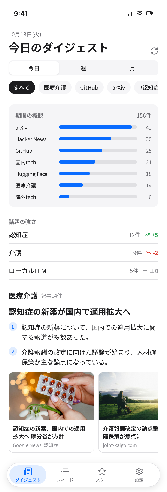
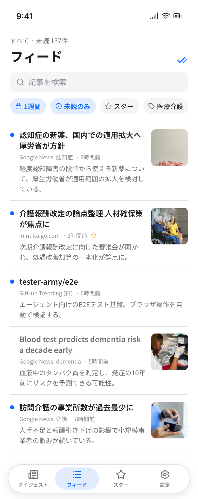
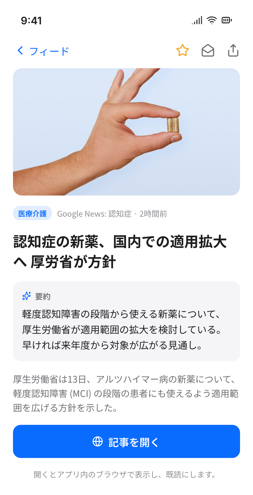
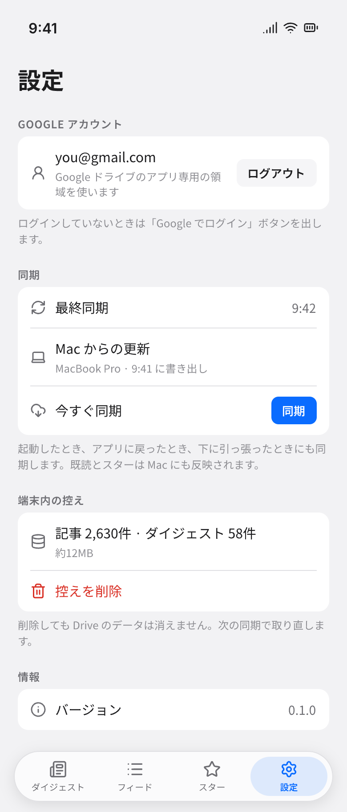
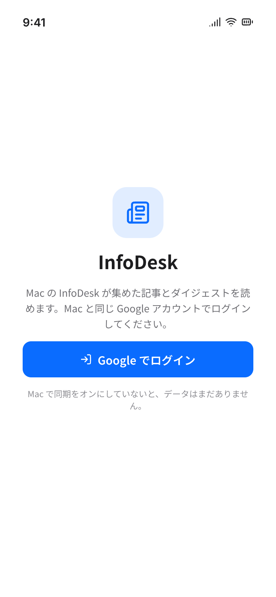
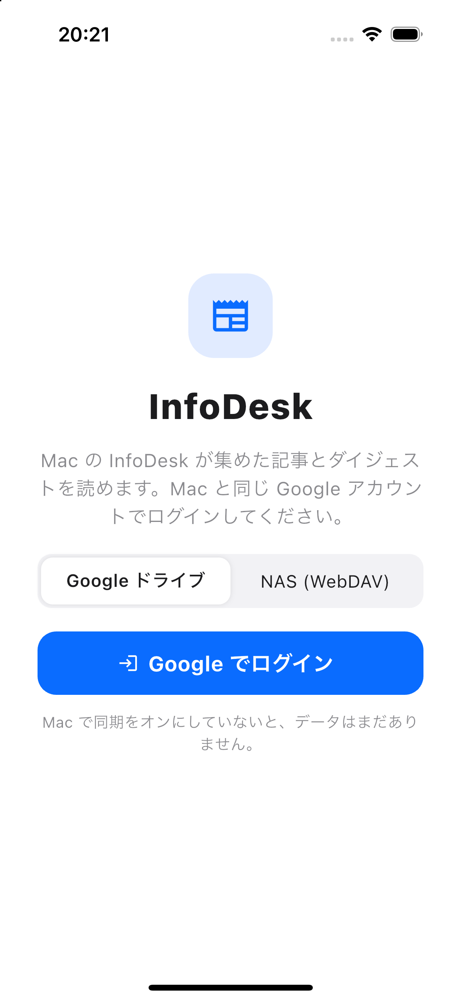
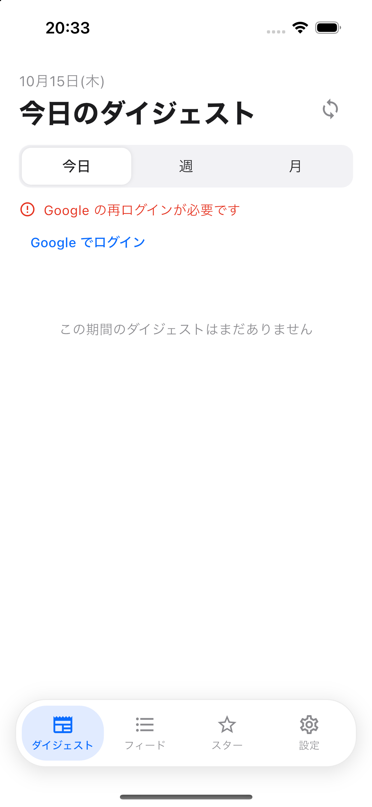

**日本語: [14-mobile-app.ja.md](14-mobile-app.ja.md)** | ← [NAS Setup](13-nas-setup.md)

# Mobile App

The InfoDesk mobile app (Flutter, in `mobile/`) is a reader for the sync folder that the Mac app writes. You read the digest, the feed and single articles on your phone, and the read and starred marks you set there reach the Mac, and the other way round. The app is in Japanese. It has been built and run on the iOS simulator only.

For the sync folder, its files and the retention rules, see [Cloud Sync](12-cloud-sync.md). For the NAS side, see [NAS Setup](13-nas-setup.md).

## 1. What it does

- Shows the digests (today, week, month), the article feed and single articles that the Mac collected and summarized.
- Keeps a local copy of them in a database on the phone, so you can read without a network.
- Sets read and starred marks. They are sent to the sync folder and reach the Mac at its next sync. Marks made on the Mac reach the phone at the phone's next sync. When both change the same article, the newer change wins.
- Never collects articles, never makes summaries and never changes what the Mac wrote. The Mac must have sync turned on, or the folder has no data yet.

## 2. The screens

Four tabs sit under a floating bar: ダイジェスト (digest), フィード (feed), スター (starred) and 設定 (settings). The images marked "design mockup" are from the design file; they show the intended layout. The two simulator screenshots show the running app.

### Digest

Switch between 今日 (today), 週 (week) and 月 (month). Each digest shows the period overview (count per category and topic strength), the headline, numbered points with image cards, and the source articles ("根拠記事"). Pull down to sync. A sync button sits at the top right.

### Feed and starred

The feed lists articles with a small image. You can narrow it by period (今日, 3日, 1週間, 1ヶ月, すべて), by category or topic, by "未読のみ" (unread only), by スター, and by a search box ("記事を検索"). "さらに表示" loads more. The button "すべて既読にする" marks the listed articles read. The スター tab is the same feed with only starred articles. Pull down to sync.

### Article

An article shows its image, category, source and time, the AI summary ("要約") and the excerpt. The top bar has star, read or unread, and share (copies the link). "記事を開く" opens the page in the in-app browser (SFSafariViewController on iOS) and marks the article read. The browser has no buttons of its own for stars, so use this screen to star.

### Settings

Settings has the storage choice ("保存先"), the Google account or the Tailscale and NAS forms, the last sync time and the time of the Mac's last update, "今すぐ同期", the local copy ("端末内の控え") with "控えを削除", and the app version.

## 3. First launch and choosing a storage

On first launch the app asks where the Mac syncs to. This must be the same storage the Mac uses.

- **Google ドライブ.** Press "Google でログイン" and sign in with the same Google account as on the Mac. The app reaches only the hidden app-only area of Drive (scope `drive.appdata`), and also asks for `openid` and `email` to show your address. You enter no password in InfoDesk.
- **NAS (WebDAV).** The phone reaches the NAS through a Tailscale node inside the app. No Tailscale app and no system VPN is needed. Choose "NAS (WebDAV)", then:
  1. Press "Tailscale にログイン". The browser opens a Tailscale page; sign in with the same account as the NAS and allow the device. The device appears as `infodesk-mobile` in the Tailscale admin console. If your tailnet uses device approval, approve it there.
  2. Enter the NAS URL (`http://<NAS name>:5005/infodesk/`), the user name and the password.
  3. Press "確かめる". The app lists the folder, and shows "読み取れました" on success. (Unlike the Mac, the phone writes no temporary file for this check.)

  The NAS side (WebDAV Server, the shared folder, the user, Tailscale on the NAS) is set up once, as in [NAS Setup](13-nas-setup.md). The app shows the same five steps under "NAS の準備を見る (初めての方へ)".

The first sync starts after sign-in (Google) or after a successful "確かめる" (NAS). The first screen after that is the digest. If the Mac has not synced yet, the screen says there is no data and asks you to sync on the Mac.

## 4. When it syncs

- When the app opens.
- When you return to the app from the background.
- When you pull down on the digest or the feed.
- When you press "今すぐ同期" (the "同期" button) in Settings, or the sync button on the digest.

A sync never overlaps another one; a request during a sync joins it. If the network is down, nothing is lost and the next sync retries.

## 5. What it writes

The app only reads the files the Mac wrote (`manifest.json`, `meta.json.gz`, `day-*`, `digest-*`, `state-snapshot.json.gz`). It writes only its own change batches, `ops-<device id>-<time>-<number>.json`, each created once and never edited, holding your read and starred changes. It does not delete or overwrite anything in the folder. Article images are not in the folder; the phone loads them from the original sites.

## 6. Deleting the local copy

"控えを削除" in Settings (with a confirm) deletes the articles and digests stored on the phone. The data in the storage is not touched, and the next sync fetches everything again. Marks that were not yet sent are lost, so sync first if you want to keep them. Switching the storage between Google Drive and NAS also clears the local copy, but keeps unsent marks. Changing the NAS URL while NAS is chosen clears it too.

## 7. Privacy

- Tailscale log upload is switched off: the in-app node is started with Tailscale's "no logs, no support" option, so it does not send logs to Tailscale.
- The NAS password is kept in the iOS Keychain (the secure storage on Android), not in the app database. The URL and user name are in the app database.
- Google sign-in goes through Google's own sign-in screen, so you type no Google password into InfoDesk, and the app asks only for the scopes `drive.appdata` (its hidden Drive area), `openid` and `email` (to show your address).
- The Tailscale state (the device key) is saved in the `tailnet` folder under the app support directory and is excluded from device backups. If the exclusion cannot be set, the app does not start Tailscale and shows 「Tailscale の状態をバックアップから除外できません」.
- Sync data goes only to Google Drive, or to your NAS inside your tailnet. See [Privacy and Security](09-privacy-and-security.md).

## 8. Troubleshooting

The app shows these messages next to the sync controls, under the storage settings, or as the result of "確かめる".

| Message | Meaning and fix |
|---|---|
| 「Google の再ログインが必要です」 | The Google token no longer works. Press "Google でログイン" again (on the digest, or in Settings). |
| 「Google にログインできませんでした」 | The sign-in failed (not just dismissed). Try again. |
| 「ネットワークに接続できません。次の同期で再試行します。」 | The storage could not be reached (network, timeouts, HTTP 408, 429 or 5xx). Nothing is lost and the next sync retries. For NAS, check that the NAS is connected in the Tailscale admin console and that WebDAV Server runs on port 5005. |
| 「同期フォルダにまだデータがありません。Mac で同期してください。」 | The folder has no `manifest.json`. Turn on sync on the Mac and sync there. |
| 「NAS のユーザー名かパスワードが違います」 | The NAS answered 401. Enter the user name and password again. |
| 「NAS のフォルダに書き込む権限がありません」 | The DSM user lacks "Read/Write" on the shared folder. |
| 「NAS の空き容量が足りません」 | The NAS volume is full or over quota. |
| 「NAS の URL を確かめてください (転送されました)」 | The NAS redirected the request. Use `http://<NAS name>:5005/<folder>/`, with `http` and port 5005. |
| 「NAS の URL を確かめてください (例: http://takeuchi-nas:5005/infodesk/)」 | The URL is not a plain `http://` address with a host, or it contains a user name or password. |
| 「http:// を使ってください (Tailscale の中なので暗号化されています)」 | The URL starts with `https://`. Use `http://`. |
| 「NAS が Tailscale の中に見つかりません。NAS の名前を確かめてください」 | The URL host is not a device in your tailnet, so nothing was sent. Use the NAS name from the Tailscale admin console, or its `100.x.y.z` address. |
| 「NAS の URL、ユーザー名、パスワードを入力してください」 | One of the three NAS fields is empty. |
| 「NAS のパスワードをキーチェーンに保存できません」 / 「NAS のパスワードを読めません」 | The Keychain could not be written or read (for example when it is locked). Unlock the phone and try again. |
| 「Tailscale にログインしてください」 | The in-app node is not logged in. Press "Tailscale にログイン". |
| 「Tailscale が停止中です」 | The phone has logged in before, but the node is stopped. Press "Tailscale にログイン" to start it. |
| 「Tailscale の管理画面でこの端末を承認してください」 | Device approval is on. Approve `infodesk-mobile` in the admin console. |
| 「Tailscale のサーバーにつないでいます」 / 「ログインの準備をしています」 | The node is starting. After 30 seconds the app offers "もう一度試す" and "状態を消してやり直す". |
| 「起動できませんでした: …」 | The node failed to start; the reason follows. Use "この端末の Tailscale の状態を消す" (with a confirm), then log in again. Delete the old `infodesk-mobile` in the admin console too. |
| 「Tailscale の状態を読めません。「状態を消してやり直す」を押してください」 | The saved Tailscale state is unusable. Reset it with the button, then log in again. |
| 「Tailscale を初期化できません」 | Tailscale could not be set up on this phone. Restart the app. When a start fails for another reason, the line reads 「起動できませんでした: Tailscale を起動できませんでした」 (the reason is shown only when it is already Japanese). |
| 「Tailscale の状態をバックアップから除外できません」 | See section 7. Restart the app. |
| 「保存先のエラー: …」 | Any other storage error, with the detail after the colon. |
| 「記事を開けませんでした」 | The article page could not be opened in the browser. |
| 「処理に失敗しました。もう一度お試しください」 | An unexpected failure. Try again. |

If the Mac wrote the sync folder in a newer format, the sync stops before reading or writing anything and shows 「同期データの形式が新しくなっています。アプリを更新してください」 (update the app).

The sync can also show these warnings. They do not stop the sync: 「manifest.json を読めませんでした」, 「<file> のハッシュが一致しないため取り込みませんでした」, 「<file> を読めませんでした」.

## 9. Developer build

The full commands and the reasons are in [`mobile/README.md`](../mobile/README.md). In short:

- Flutter 3.44.7 (Dart 3.12.2) and Xcode 27.
- Run Flutter and Xcode as arm64. If the shell runs under Rosetta, wrap the commands with `arch -arm64`.
- Go 1.26 or newer must be on `PATH`: the `tailscale` package builds its native library with Go on the first build.
- `ios/Flutter/Debug.xcconfig` and `Release.xcconfig` pin `ARCHS[sdk=iphonesimulator*] = arm64`, because the `lipo` in Xcode 27 rejects the `-verify_arch arm64 x86_64` check that flutter_tools runs. The cost is no x86_64 simulator.
- The iOS Google client id is not committed. In Google Cloud Console, in the same Cloud project as the Mac's desktop OAuth client (so both see the same `drive.appdata` folder), create an OAuth client of type "iOS" with bundle id `jp.infodesk.mobile`. Download its plist, then generate the git-ignored `ios/Flutter/Secrets.xcconfig` with `mobile/tool/ios_oauth_from_plist.sh <plist>`.
- Android is not supported yet: there are no backup rules for the Tailscale state and the minimum SDK is not set for it. Only the iOS app is built and tested.
- Simulator: `flutter build ios --simulator --debug`, then install and launch `jp.infodesk.mobile` with `xcrun simctl`.
- A real device needs a signing team.

## 10. Manual check before you rely on it

Automated tests use fake storages, so these checks need you:

1. Google, on the iOS simulator: choose "Google ドライブ", sign in with the Mac's account, and confirm that a sync brings in the digest and the feed.
2. NAS: choose "NAS (WebDAV)", log in to Tailscale on the phone, approve `infodesk-mobile` in the admin console if asked, enter the URL and user, press "確かめる" (expect "読み取れました"), then sync and confirm the data arrives.
3. Phone to Mac: star and read an article on the phone, sync the phone, sync the Mac ("今すぐ同期"), and confirm the marks show on the Mac.
4. Mac to phone: read and star another article on the Mac, sync the Mac, pull down on the phone, and confirm the marks show.

See [Settings](07-settings.md) for the Mac's sync keys.
