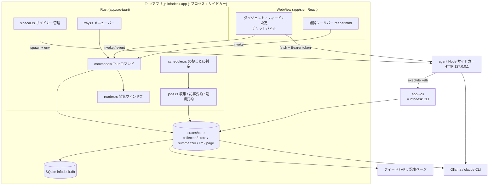
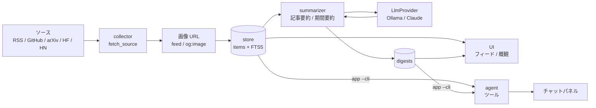

# システム設計書(アーキテクチャ)

ソースコードを修正する人向けの全体像。データ構造は[データ設計書](data-model.md)、依存の選定理由は[技術スタック](tech-stack.md)、設計判断の元は[設計書](../superpowers/specs/2026-10-06-infodesk-design.md)。

## 1. システム構成



原則:

- ロジックは `crates/core` に置き、Tauriのコマンド、CLI、サイドカー(CLI経由)がすべて同じ関数を呼ぶ。記事の絞り込みやトピックの照合は1か所にしか無い。
- DBは1ファイル。アプリは `Mutex<Store>` で直列化して使い、ロックは同期処理の間だけ保持する(`AppState::with_store`)。LLMやHTTPを待つ間はロックを持たない。
- 画面への通知はTauriイベントで行い、画面は受け取ったら再取得する(`status-changed`、`items-changed`、`digests-changed`、`chat-endpoint-changed`、`open-settings`、`reader-state`)。差分を送らない。

## 2. データフロー

収集から画面とチャットまでの流れ。



1. **collector**(`collector/mod.rs`): `fetch_all` が有効なソースを順に取得する。1件の失敗で他を止めない。`fetch_source` が `SourceKind` で取得器(`feed`、`github`、`hackernews`、`huggingface`)へ振り分ける。DBには触れない。
2. **画像**: 取得器が決めた `image_url` に加え、新しい記事で画像が無いものだけ `images::fill_page_images` が記事ページの `og:image`(なければ `twitter:image`)を読む。同時4件、1件10秒、先頭512KBまで。arXivとGoogle Newsの転送URLは取りに行かない。
3. **store**: `apply_outcomes` が `upsert_items` で保存し、ソースごとに `record_fetch` で成否を残す。URLが一意で、既存の記事は `score` だけ更新する。
4. **summarizer**: 記事要約は各カテゴリーの上位N件(`summary.top_n`、既定20)に日本語1〜2文を付ける。期間要約は階層式(日次は記事から、週次は日次要約から、月次は週次要約から)。トピック別は期間によらず該当記事から直接作る。LLMを呼ぶ前後の計画(`plan_*`)と保存(`finish_*`)は同期関数で、LLM呼び出しだけが非同期(モックで単体テストできる)。
5. **digests**: `digests` に `pending` / `done` / `failed` で保存する。UIは `get_digests` で読み、`digest_stats` でLLMを使わない概観を得る。
6. **UI**: 画面を描く。記事を開くときは `open_item`(閲覧ウィンドウか既定のブラウザ)。
7. **agent(`--cli`)**: チャットのツールは `INFODESK_CLI` にアプリ本体の実行ファイルを、`INFODESK_CLI_ARG=--cli` を前置き引数として受け取り、`<app> --cli --db <DB> items --json` のように呼ぶ。`app/src-tauri/src/main.rs` が先頭引数 `--cli` を見て `infodesk_cli::run_from` に渡すので、別バイナリを同梱せずに済む。

## 3. クレートと依存関係

```
app/src-tauri (infodesk-app) ──> crates/cli (infodesk, lib名 infodesk_cli) ──> crates/core (infodesk-core)
        └──────────────────────────────────────────────────────────────────────> crates/core
agent/ (Node)  ... Rustに依存しない。実行時にアプリの --cli を子プロセスで呼ぶ
```

- `core` はTauriもclapも知らない。
- `cli` はclapの定義と出力整形(`json.rs`)だけ。ロジックは `core`。
- アプリは `cli` を `infodesk` クレートとして依存し、`--cli` で呼ぶ。

## 4. フォルダ・ファイルマップ

### `crates/core/src`

| ファイル | 責務 |
|---|---|
| `model.rs` | `Category`(7種)、`SourceKind`(6種)、`Period`、`DigestStatus`、`DigestScope`、`Source`、`Item`、`NewItem`、`Digest`、`Topic`、`ItemFilter`、集計の型 |
| `store/` | `mod.rs`(`Store::open`、WAL)、`schema.rs`、`migrate.rs`、`items.rs`、`sources.rs`、`topics.rs`、`digests.rs`、`settings.rs`、`stats.rs`(概観の集計)、`chat.rs` |
| `collector/` | `mod.rs`(振り分けと `apply_outcomes`)、`feed.rs`(RSS / Atom / Media RSS)、`github.rs`、`hackernews.rs`、`huggingface.rs`、`images.rs`(`og:image`)、`text.rs`(HTMLの除去と切り詰め) |
| `summarizer/` | `mod.rs`(`plan_digest` / `finish_digest` / `run_digest`、記事要約)、`prompts.rs`(指示文。期間要約は1行目に `見出し: ` を書かせる) |
| `llm/` | `mod.rs`(`LlmProvider` trait、`provider_from_settings`)、`ollama.rs`、`claude.rs`(`claude` CLIのヘッドレス実行) |
| `page.rs` | 本文取得。内部アドレスを拒否するクライアント(`page_client`)、リダイレクトの検査、2MBと20000文字の上限 |
| `period.rs` | 期間の開始、終了、UTC範囲。ローカル日付、週は月曜始まり |
| `seed.rs` | `DEFAULT_SOURCES`(22件)と `DEFAULT_SETTINGS`(16キー) |
| `error.rs` | `Error` と `Result` |

### `crates/cli/src`

`lib.rs`(clapの定義とコマンドの実行。`run_from`)、`json.rs`(`--json` の出力形)、`main.rs`。サブコマンドは [08-cli](../08-cli.md) を参照。既定のDBは `~/Library/Application Support/InfoDesk/infodesk.db`(アプリとは別。[data-model.md](data-model.md))。

### `app/src-tauri/src`

| ファイル | 責務 |
|---|---|
| `main.rs` | 先頭引数が `--cli` ならCLIとして動き、それ以外はアプリを起動する |
| `lib.rs` | ビルダー、`setup`、`generate_handler!`(コマンドの登録)、ウィンドウを閉じたときの常駐、DockのReopen |
| `state.rs` | `AppState`(`Store`、HTTPクライアント、`AppStatus`、通知関数、LLMファクトリー、サイドカー、閲覧ウィンドウの状態)、イベント名 |
| `commands/` | `status`、`settings`、`items`、`sources`、`topics`、`digests`、`chat`、`chat_endpoint`。各ファイルは `*_impl(&AppState, ...)` の純粋な関数と `#[tauri::command]` の薄い包みに分かれる |
| `jobs.rs` | `run_collect`、`run_item_summaries`、`run_digests`、`retry_pending`、`retry_all` |
| `scheduler.rs` | `run_loop`、`due_jobs`、`next_collect_at`、`ScheduleConfig` |
| `reader.rs` | 閲覧ウィンドウ(ツールバーと記事ページの2つのWebView)、URLの検査、ナビゲーションの制限 |
| `sidecar.rs` | Nodeサイドカーの起動、準備完了の待機、再起動、停止 |
| `tray.rs` | メニューバーのメニューと状態行 |
| `error.rs` | `AppError { message }`。Tauriは `Err` をJSONにして `invoke` のrejectへ渡す |
| `capabilities/default.json` | メインウィンドウと `reader-toolbar` のWebViewに与える権限 |
| `tauri.conf.json` / `tauri.bundle.json` | CSP、ウィンドウ、バンドル。`tauri.bundle.json` は `agent/dist/agent.mjs` を `agent/agent.mjs` としてリソースに入れる |

### `app/src`

| パス | 責務 |
|---|---|
| `main.tsx` / `App.tsx` | エントリーと全体の状態(表示、サイドバーの選択、チャットの開閉、イベントの購読) |
| `api.ts` / `types.ts` | `invoke` の型付きラッパーと型、イベント名(`EVENTS`) |
| `components/` | `Sidebar`、`Segmented`、`Toggle`、`ErrorLine`、`RevealCard`、`ChatToggle`、`charts/`(`BarChart`、`Sparkline`) |
| `views/` | `DigestView`(+ `digest/Overview`、`digest/ImageCards`)、`FeedView`、`SettingsView`(+ `settings/` の4タブとRSS追加ダイアログ) |
| `chat/` | `ChatPanel`、`ChatThread`、`ThreadMenu`、`WorkSummary`、`ToolCall`、`Reasoning`、進行表示と文脈のロジック |
| `reader/` | 閲覧ウィンドウのツールバー(`reader.html` から読む別エントリー) |
| `lib/` | 日付、絞り込み条件、見出しの取り出し |
| `styles/` | `theme.css`(トークンと基本部品)、`layout.css`、`digest.css`、`chat.css`、`reader.css` |
| `test/` | `setup.ts`、`ipc.ts`(Tauri IPCのモック)、`stream.ts` |

### `agent/src`

| ファイル | 責務 |
|---|---|
| `main.ts` | 環境変数を読み、HTTPサーバーを起動し、`INFODESK_AGENT_READY {"port":N}` を標準出力へ1行書く。標準入力が閉じたら終了する |
| `server.ts` | `POST /chat`、`GET /health`。Bearerトークンの検査、許可するOriginは `tauri://localhost` と `http://localhost:1420` だけ。本文は5MBまで |
| `chat.ts` | 回答の生成。Ollamaは `ToolLoopAgent`(最大20ステップ)、Claudeは `claude` CLIにMCPでツールを橋渡し(最大20ターン)。開始と終了の時刻、`finishReason`、思考をストリームに載せる |
| `tools.ts` | ツールの定義 |
| `prompt.ts` / `context.ts` | 指示文と、画面の文脈(範囲、期間、添付)の整形 |
| `models.ts` | モデルの作成。Ollamaの `num_ctx` は16384、ClaudeのモデルはCLI経由の `sonnet` |
| `cli.ts` | `execFile` で `<cli> --db <DB> <引数>` を実行(60秒、出力の上限あり) |
| `errors.ts` / `stdout-guard.ts` / `env.ts` | エラーの分類、標準出力の保護(合図の1行以外を出さない)、環境変数 |

## 5. ジョブとスケジューラー

### 起動時(`lib.rs` の `setup`)

1. `app_data_dir()/infodesk.db` を開き(マイグレーションが走る)、`seed_defaults` で不足する設定と初回の初期ソースを入れる。
2. `AppState` を作り、保存済みの最終収集時刻を読む(`load_persisted`)。
3. メニューバーを作る。引数に `--hidden`(ログイン時の自動起動)が無ければメインウィンドウを表示する。
4. `scheduler::run_loop` を起動する。
5. チャットのサイドカーを起動する(`Sidecar::restart`)。

### ジョブ(`jobs.rs`)

| ジョブ | 内容 |
|---|---|
| `run_collect` | 収集 → 画像 → 保存 → 当日の記事要約 → 当日の日次要約(強制再生成)。収集中に再度呼ぶと `collect already running` で拒否し、`last_error` は変えない。有効な全ソースが失敗したときは `last_error` に「全ソースの取得に失敗しました」を入れ、最終収集時刻を前にずらして約10分後に再試行させ、要約は作らない |
| `run_item_summaries` | カテゴリーごとに上位N件のうち要約が無いものへ。1件失敗したら残りを中止する(LLMが落ちているときに全件待たない) |
| `run_digests` | 指定の期間とscopeを順に生成。`digesting` フラグはジョブ数で管理し、重なっても最後の1つが終わるまで立つ |
| `retry_pending` / `retry_all` | `pending` だけ(自動)/ `pending` と `failed`(手動)を再試行 |

LLMは `LlmFactory`(`provider_from_settings`)で用途(`LlmRole::Items` / `Digest`)ごとに作る。**Claudeが失敗してもOllamaへ自動で切り替えない**(選んだプロバイダー以外へ内容を送らないため)。

### スケジューラー(`scheduler.rs`)

- 60秒ごとに起き(`MissedTickBehavior::Delay`)、設定と最終実行の記録から「実行すべきジョブ」を計算する(`due_jobs`)。時計ではなく記録との差で判定するので、停止中に逃した分は次の起動または復帰で1回だけ補われる。
- ジョブは `Collect`、`Daily(日)`、`Weekly(週の月曜)`、`Monthly(月の1日)`。
- 収集: 最終収集 + 間隔(`schedule.collect_interval_hours`、1〜168時間)を過ぎたら。
- 日次: 設定の時刻を過ぎたら前日を確定する。続けて現在の週次と月次を強制再生成する(`job_plan`)。
- 週次: 設定の曜日と時刻を過ぎたら前週を生成する。月次: 1日の設定時刻を過ぎたら前月を生成する。
- 記録するキー: `schedule.last_collect_at`、`last_daily_for`、`last_weekly_for`、`last_monthly_for`。週次と月次は生成に失敗したら記録しない(次の判定で再び対象になる)。
- 同じジョブを15分以内に再実行しない(`RECENT_ATTEMPT`)。実行すべきジョブが無い判定のとき、15分に1回 `retry_pending` を呼ぶ。
- 手動実行: `collect_now`、`regenerate_digest`、`retry_pending_digests` は `tauri::async_runtime::spawn` して即座に返る。進行はイベントで通知する。

### 常駐とメニューバー

- `app.stay_resident`(既定 `true`)のとき、メインウィンドウの閉じる操作は `prevent_close` して非表示にする。閲覧ウィンドウ(`reader`)は対象外。
- DockのアイコンでReopenされたらメインウィンドウを表示する。
- メニュー項目: 状態行、未読行、今すぐ収集、ウィンドウを開く、設定、終了(`tray.rs`)。状態行は `status-changed` と `items-changed` で更新する。

## 6. チャットのサイドカー(`sidecar.rs`)

1. 設定 `node.bin` を `/opt/homebrew/bin` と `/usr/local/bin` を足したPATHから解決する(GUIから起動したアプリのPATHは短いため)。
2. `node --version` を確かめ、22未満は `node_too_old`、見つからなければ `node_missing`、`agent.mjs` が無ければ `agent_missing`。それ以外の失敗は `start_failed`。
3. 子プロセスに環境変数を渡して起動する:

| 環境変数 | 値 |
|---|---|
| `INFODESK_CLI` | アプリ本体の実行ファイル(`current_exe`) |
| `INFODESK_CLI_ARG` | `--cli` |
| `INFODESK_DB` | アプリのDBのパス |
| `INFODESK_AGENT_TOKEN` | 起動ごとに `/dev/urandom` から作る16バイトの16進文字列 |
| `INFODESK_AGENT_PORT` | `0`(空きポートを使う) |
| `PATH` | 上の追加ディレクトリを足したもの |

4. 子が標準出力に `INFODESK_AGENT_READY {"port":N}` を書くのを最大20秒待つ。準備後も標準出力と標準エラーは読み捨てる(パイプが詰まらないように)。
5. 結果を `ChatEndpoint`(`starting` / `ready{url,token}` / `error{kind,message}`)として保持し、`chat-endpoint-changed` を発行する。画面は `chat_endpoint` で読み、`url` へ直接 `fetch` する(CSPの `connect-src` が `http://127.0.0.1:*` を許す)。
6. アプリの終了で `stop()`。子の標準入力が閉じても子が自分で終了する。`restart_chat` で起動し直せる。
7. `agent.mjs` の場所は、バンドルでは `Resource/agent/agent.mjs`、デバッグビルドで見つからなければリポジトリの `agent/dist/agent.mjs`(`agent` で `npm run build` が必要)。

## 7. 閲覧ウィンドウ(`reader.rs`)

- ウィンドウ `reader` に2つのWebViewを置く(Tauriの `unstable` 機能 `add_child`)。上の `reader-toolbar`(高さ44、アプリに同梱した `reader.html`)と、下の `reader-content`(記事ページ、外部URL)。
- **記事ページのWebViewには権限を与えない**。`capabilities/default.json` が許す対象は `main` ウィンドウと `reader-toolbar` WebViewだけで、`reader-content` は含まれない。
- 開ける対象は `http` / `https` のみ。`localhost` 系、ループバック、プライベート、リンクローカル、未指定、マルチキャストのIPは閲覧ウィンドウが拒否し(アプリのオリジンと重なるとIPCが使えてしまうため)、`open_item` と `open_link` は代わりに既定のブラウザで開く(`open_target`)。
- ページ内の移動(`on_navigation`)も同じ検査を通す。`target="_blank"` は新しい窓を作らず、同じ記事ページで開く(`on_new_window` で拒否して `navigate`)。
- 窓の作成は `reader_lock` で1つずつにする(同時の最初のopenが2つ作らないように)。
- `reader-state` イベントで現在のURLとタイトルをツールバーへ送る。

## 8. 設定画面の保存規則

- 画面から書けるのは `DEFAULT_SETTINGS` のキーだけ(`set_setting`)。`app.launch_at_login` は専用コマンド `set_launch_at_login`。
- `claude.bin` と `node.bin` は、コマンド名(`[A-Za-z0-9_.-]+`)か、存在する通常ファイルの絶対パスだけ受け付ける。
- CLIの `config set` にはこの検査が無い(任意のキーを書ける)。

## 9. 変更レシピ

### ソースの種類(`SourceKind`)を足す

例として種類 `foo` を足す。`kind` は `sources.kind` のTEXTなので、DBのマイグレーションは要らない。

1. `crates/core/src/model.rs`: `SourceKind` に `Foo` を足し、`ALL`(配列の長さも)と `as_str`(保存値 `foo`)を更新する。
2. `crates/core/src/collector/foo.rs` を作り、`pub async fn fetch(http, ...) -> Result<Vec<NewItem>>` を書く。`NewItem` の `url` は一意キーになる。指標があれば `score` に入れる(記事要約の「上位」の基準になる)。画像が分かるなら `image_url`(`https` のみ。`images::https_image_url` を使う)。
3. `collector/mod.rs`: `mod foo;` を足し、`fetch_source` の `match` に腕を足す。`cargo build` が他の網羅漏れ(`jobs.rs`、`commands/sources.rs`、`cli/json.rs`、`store/` など)を教えるので直す。
4. 記事ページの `og:image` 取得が不要な種類は `images::wants_page_image` で除外する(arXivとGoogle Newsがその例)。
5. 初期ソースに入れるなら `seed.rs` の `DEFAULT_SOURCES` に足す。ただし初期ソースは新規DBにだけ入る(`seeded` キー)。既存のDBへ入れるには、ユーザーが追加するか、マイグレーションで入れる必要がある。
6. UI: `app/src/types.ts` の `SourceKind` ユニオンに `"foo"` を足す。
7. テスト: 実レスポンスを `crates/core/tests/fixtures/` に保存し(`examples/fetch_fixtures.rs` の `TARGETS` に足すと `cargo run -p infodesk-core --example fetch_fixtures` で取り直せる)、パーサーを単体テストする。取得は `wiremock` で試す。
8. 利用者向けの文書: [03-sources-and-topics](../03-sources-and-topics.md) と、このファイルのマップ。

### 設定キーを足す

1. `crates/core/src/seed.rs` の `DEFAULT_SETTINGS` に `("foo.bar", "既定値")` を足す。これで(a)起動時に補われ、(b)`get_settings` が返し、(c)`set_setting` が受け付ける。保存の仕組みについては通常これだけで足りる。
2. 値の検査が要るなら `app/src-tauri/src/commands/settings.rs` の `set_setting_value` に足す(実行ファイルの検査は `EXECUTABLE_SETTINGS` に足すだけ)。
3. 読み出す側: Rustは `store.get_setting_or("foo.bar", "既定値")`(既定値は `DEFAULT_SETTINGS` と同じにする)。サイドカーは `config list --json` の結果(`Settings`)から読む。
4. 画面: `app/src/views/settings/` の該当タブに `SettingField` / `Toggle` / `Segmented` を足し、`save("foo.bar", v)` を呼ぶ。`useSettingsState` が保存後に再取得する。
5. スケジュールに効く値なら `scheduler.rs` の `ScheduleConfig::from_settings` に足し、`due_jobs` のテストを足す。
6. テスト: `commands/settings.rs` のテスト(未知のキーの拒否、既定値の一覧)と、画面のテスト。
7. [07-settings](../07-settings.md) の表と、[data-model.md](data-model.md) の設定表を更新する。

内部の記録用キー(`schedule.last_*` など)は `DEFAULT_SETTINGS` に入れない。画面から書けてしまうため。

### Tauriコマンドを足す

1. `app/src-tauri/src/commands/<領域>.rs` に、純粋な関数 `foo_impl(state: &AppState, ...) -> AppResult<T>` を書き、その下に薄い包み:

   ```rust
   #[tauri::command]
   pub fn foo(state: State<'_, AppState>, ...) -> AppResult<T> { foo_impl(&state, ...) }
   ```

   ストアを変える処理は、終わりに `state.notify(EVENT_ITEMS)` などで画面へ知らせる。時間のかかる処理は `tauri::async_runtime::spawn` して即座に返し、進行はイベントで通知する(`collect_now` と同じ)。
2. 新しいファイルなら `commands/mod.rs` に `pub mod` を足す。
3. `app/src-tauri/src/lib.rs` の `generate_handler![ ... ]` に `commands::<領域>::foo` を足す。**登録を忘れると実行時に `invoke` が失敗する**(コンパイルは通る)。
4. `app/src/api.ts` に型付きラッパー(`foo: (...) => invoke<T>("foo", { ... })`)を足し、型は `types.ts` に置く。引数名はRust側の引数名のキャメルケース(`thread_id` は `threadId`)。
5. アプリのコマンドには `capabilities` の追加は要らない(`build.rs` はアプリのコマンドの許可リストを作っていない)。プラグインやコアの権限を使うときだけ `capabilities/default.json` に足す。
6. テスト: `*_impl` を `state::test_state()`(インメモリのDBと、発行したイベントの記録)で試す。画面側は `app/src/test/ipc.ts` の `setupIpc` にハンドラを足す。未登録のコマンドは `unmocked` に記録されて失敗するので、取りこぼしに気づける。
7. 記事ページ側のWebViewから呼ばせてはいけないコマンドは、閲覧ウィンドウの権限の範囲(`webviews`)に注意する。

### チャットのツールを足す

1. `agent/src/tools.ts` の `createInfodeskTools` に、`tool({ description, inputSchema: z.object({...}), execute })` を足す。`description` と入力の説明は日本語で、モデルが使い分けられる粒度にする。
   - 記事やDBに触れるなら、CLIの `--json` を呼ぶ(`run(["サブコマンド", ..., "--json"], abortSignal)`)。必要なCLIの出力が無ければ `crates/cli/src/lib.rs` にサブコマンドを、`json.rs` に出力の形を足す(絞り込みのロジックは `core` に置く)。
   - 外部サービスに出るなら、設定がある場合だけ有効にする(`web_search` が例)。
   - 入力の検査は `zod` で行う。Claudeの経路(MCP橋渡し)は `refine` が効かないので、`execute` の中でも検査する(`read_digests` が例)。
2. `TOOL_NAMES` に名前を足す。Claudeでは `createAiSdkMcpServer` で `mcp__infodesk__<名前>` として公開され、許可リストはツールの一覧から自動で作られる(`chat.ts`)。
3. 指示文: `agent/src/prompt.ts` の「ツールの使い方」に使いどころを足す。
4. 画面の表示: `app/src/chat/toolLabels.ts` の `LABELS` に表示名、`describeTool` に1行の要約、`toolDetails.ts` に開いたときの行を足す。足さないと生のツール名が出る。計画のように通常のツール行に出さないものは別扱い。
5. テスト: `agent/test/tools.test.ts`(偽のCLI `fake-infodesk.mjs` を使う)、`app/src/chat/toolLabels.test.ts` と `toolDetails.test.ts`。
6. [06-ai-chat](../06-ai-chat.md) のツールの表と、[09-privacy-and-security](../09-privacy-and-security.md) を更新する(外部への通信が増える場合は特に)。

### DBのスキーマを変える

1. `crates/core/src/store/migrate.rs` の `MIGRATIONS` に `(N+1, "SQL")` を足し、`SCHEMA_VERSION` を上げる。既存の列を壊さない追加を基本にする。
2. 旧版のDBから上げても既存の行が残るテストを `migrate.rs` の `tests` に足す。
3. `model.rs` の型、`store/` の読み書き、必要なら `cli/json.rs` と `app/src/types.ts` を更新する。
4. [data-model.md](data-model.md) の版の表を更新する。
