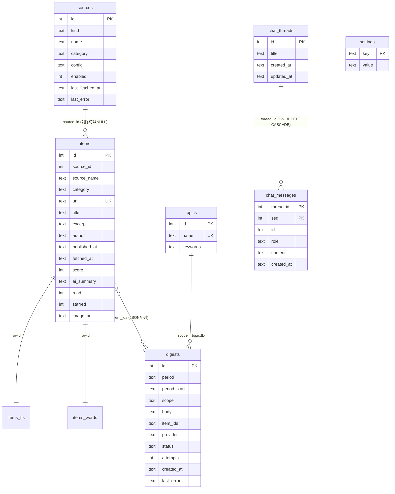
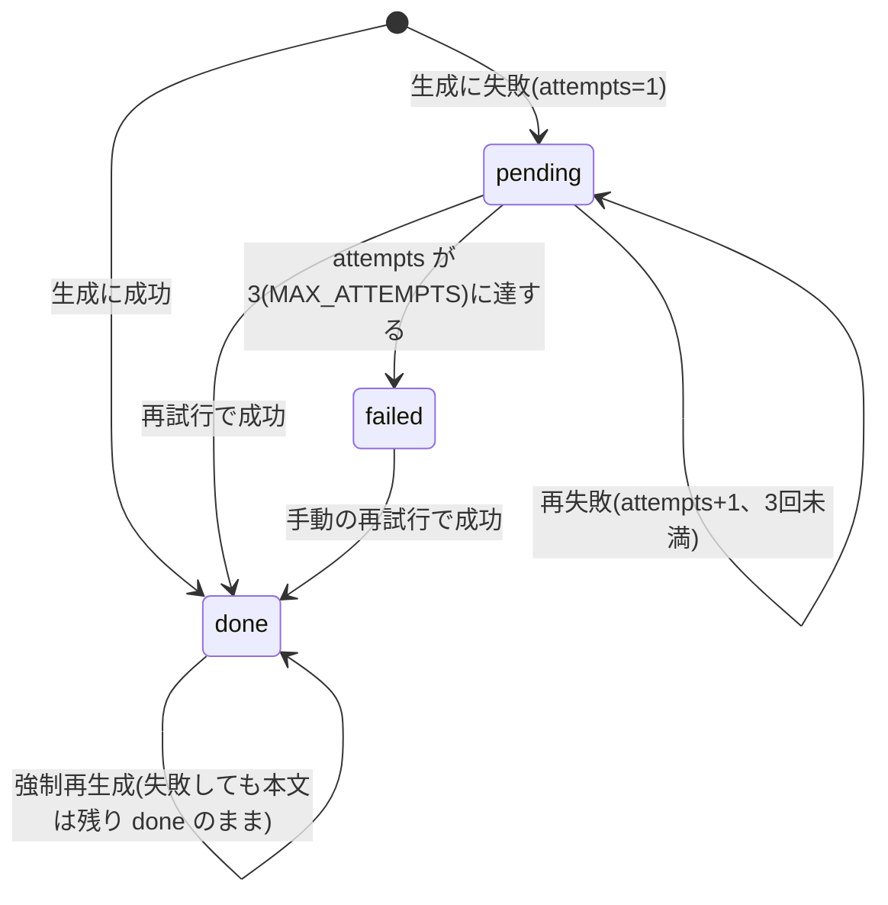

# データ設計書

実装の正は `crates/core/src/store/`(`schema.rs` と `migrate.rs`)と `crates/core/src/model.rs`。設計書8節と12節の「データモデル」を、実装した形で書き直したもの。

## 1. 保存場所

InfoDeskの永続データはSQLite 1ファイルだけ。

| 使い手 | 既定のパス | 備考 |
|---|---|---|
| アプリ | `~/Library/Application Support/jp.infodesk.app/infodesk.db` | `app_data_dir()` + `infodesk.db`(`app/src-tauri/src/lib.rs`)。バンドルidが `jp.infodesk.app` |
| CLI(`infodesk`) | `~/Library/Application Support/InfoDesk/infodesk.db` | `crates/cli/src/lib.rs`。**アプリとは別のファイル**。`--db <パス>` で変更できる |
| チャットのサイドカー | アプリのDBと同じファイル | アプリが環境変数 `INFODESK_DB` で渡し、ツールは `app --cli` 経由でそのDBを読む |

アプリのDBをCLIで触るときは `--db` を明示する。

`Store::open`(`store/mod.rs`)は親ディレクトリを作り、`PRAGMA journal_mode = WAL; PRAGMA busy_timeout = 5000;` を設定してからマイグレーションを実行する。アプリ、CLI、サイドカー(CLI経由)が同じファイルを同時に開くための設定。時刻は秒精度のUTC、末尾 `Z` のRFC3339文字列で保存する(`ts()`)。文字列比較が時刻順と一致する。

## 2. ER図

## 3. マイグレーション

`PRAGMA user_version` を版番号に使う(`store/migrate.rs`)。`SCHEMA_VERSION = 4`。`MIGRATIONS` の各要素は `BEGIN; <SQL> PRAGMA user_version = N; COMMIT;` として1つずつ適用する。

| 版 | 内容 | 追加した計画 |
|---|---|---|
| 1 | `schema.rs` の `SCHEMA` 全体(`sources`、`items`、`idx_items_category_fetched`、`items_fts`、`items_words`、`topics`、`digests`、`settings`)。`IF NOT EXISTS` のみなので、版0の空DBにも、`user_version` を持たなかった初期DBにも適用できる | Plan 1 |
| 2 | `ALTER TABLE digests ADD COLUMN last_error TEXT` | Plan 2a |
| 3 | `chat_threads` と `chat_messages` を作成 | チャット(Plan 3) |
| 4 | `ALTER TABLE items ADD COLUMN image_url TEXT` | 記事の画像 |

ルール:

- DBの版がコードの `SCHEMA_VERSION` より新しいときは開くのを拒否する(`Error::Invalid`)。古いアプリで新しいDBを壊さないため。
- 既存の行を残す。マイグレーションのテストが、2、4で既存行が残ることを確かめている。
- 版を足すときの手順は [architecture.md](architecture.md) の「設定キーを足す」と同じ場所(`migrate.rs`)に加えて、`SCHEMA_VERSION` を上げ、`tests` に「旧版から上げても行が残る」テストを足す。

## 4. テーブル

### sources

| 列 | 内容 |
|---|---|
| `kind` | `github_trending` / `arxiv` / `hf_models` / `hf_papers` / `hackernews` / `rss`(`SourceKind`) |
| `category` | 固定7種(下記) |
| `config` | 種類ごとの設定値。RSSはフィードURL、arXivは分類(`cs.AI`)、GitHub trendingは `daily` / `weekly` / `monthly`、他は識別用の固定文字列 |
| `enabled` | 0/1。無効なソースは収集しない |
| `last_fetched_at` / `last_error` | 収集の結果。成功すると `last_error` はクリアされる |

`UNIQUE(kind, config)`。初回起動で `seed::seed_defaults` が `DEFAULT_SOURCES`(GitHub trending 3、arXiv 3、HF 2、HN 1、RSS 13)を入れる。入れたかどうかは `settings` の `seeded` キーで判定し、2回目以降は入れ直さない(消したソースが復活しない)。

カテゴリー(`Category`、`model.rs`)の保存値と表示名:

| 保存値 | 表示名 |
|---|---|
| `github` | GitHub |
| `arxiv` | arXiv |
| `huggingface` | Hugging Face |
| `hackernews` | Hacker News |
| `tech_jp` | 国内tech |
| `tech_intl` | 海外tech |
| `medcare` | 医療介護 |

### items

- `url` は一意。`upsert_items` は `ON CONFLICT(url) DO NOTHING` で重複を捨てる。既存のURLに新しい `score` があるときだけ `score` を更新する。
- `source_name` と `category` は取得時のソースから写して持つ。ソースを削除すると `source_id` をNULLにして記事は残す(`delete_source`)。
- `ai_summary` は記事要約(日本語1〜2文)。上位N件(設定 `summary.top_n`)にだけ付く。
- `image_url` は収集時に1回だけ決める(`https` のみ。決まらなければNULL)。既存の記事には遡らない。
- `fetched_at` が期間の所属の基準(ダイジェストの集計も同じ)。
- `idx_items_category_fetched(category, fetched_at)` がカテゴリーと期間の絞り込みを支える。

### items_fts と items_words

どちらも `items` のタイトルと概要を持つFTS5の仮想テーブルで、`rowid` が `items.id`。`upsert_items` が記事を入れるたびに手で同期する(トリガーは無い)。

| テーブル | トークナイザー | 用途 |
|---|---|---|
| `items_fts` | `trigram` | 日本語を含む部分一致。3文字以上のキーワード |
| `items_words` | `unicode61` | 英数字だけのキーワードの単語単位の照合(`AI` が `again` に一致しない)。`unicode61` はCJKを含む連なりを1語にするため、U+2E80以上の文字を空白に置き換えて入れる |

照合の規則(`store/items.rs` の `keyword_clause`):

- 英数字だけのキーワード: `items_words` で単語一致(大文字小文字は区別しない)。
- それ以外で3文字以上: `items_fts` の部分一致。
- それ以外で3文字未満: `LIKE`(trigramは3文字未満に一致しないため)。
- FTS5に渡す語句はフレーズとして引用し、FTS5の演算子を無効にする。

トピックの所属は保存せず、検索時にこの規則で照合する。トピックを足したり変えたりしても過去の記事に遡って効く。

### topics

`name` は一意。`keywords` は文字列の配列をJSONにして保存する(前後の空白と空要素は除く)。キーワードを変更またはトピックを削除すると、同じトピックの期間要約(`digests.scope = 'topic:<id>'`)を同じトランザクションで削除する(`delete_topic_digests`)。

### digests

| 列 | 内容 |
|---|---|
| `period` | `day` / `week` / `month` |
| `period_start` | 期間の開始日(ローカル日付、`YYYY-MM-DD`)。週は月曜、月は1日 |
| `scope` | `category:<保存値>` または `topic:<id>`(`DigestScope::key`) |
| `body` | 要約本文。1行目に `見出し: ` で始まる見出し行を持つことがある(古い要約は無い) |
| `item_ids` | 根拠記事のid配列(JSON) |
| `provider` | 生成した `LlmProvider::name()` |
| `status` | `pending` / `done` / `failed`(`DigestStatus`) |
| `attempts` / `last_error` | 失敗の回数と最後のエラー |

`UNIQUE(period, period_start, scope)`。状態遷移:

- 失敗の記録は `mark_digest_attempt_failed`。`status != 'done'` の行にだけ効くので、生成済みの要約は失敗で壊れない。
- スケジューラーの自動再試行は `pending` だけ、設定画面と「今すぐ再試行」は `pending` と `failed` の両方(`jobs::retry_pending` と `retry_all`)。
- 該当期間に入力が無いカテゴリーは行を作らない。

### settings

キーと値の文字列。値の既定は `seed.rs` の `DEFAULT_SETTINGS`(16キー)。`seed_defaults` が起動時に足りないキーだけ補う。画面とTauriコマンドが読み書きできるのは `DEFAULT_SETTINGS` にあるキーだけ(`set_setting` は未知のキーを拒否する)。

| キー | 既定値 | 内容 |
|---|---|---|
| `llm.items_provider` | `ollama` | 記事要約のプロバイダー(`ollama` / `claude`) |
| `llm.digest_provider` | `ollama` | 期間要約のプロバイダー |
| `llm.chat_provider` | `ollama` | チャットの既定プロバイダー |
| `ollama.base_url` | `http://localhost:11434` | |
| `ollama.model` | `gemma4:26b` | |
| `ollama.web_search_api_key` | 空 | 空ならチャットの `web_search` を無効にする |
| `claude.bin` | `claude` | コマンド名、または存在する通常ファイルの絶対パスだけ受け付ける |
| `node.bin` | `node` | 同上。チャットのサイドカーを動かすNode |
| `summary.top_n` | `20` | カテゴリーごとに記事要約を付ける件数 |
| `schedule.collect_interval_hours` | `3` | 読み取り時に1〜168へ丸める |
| `schedule.daily_time` | `07:00` | `HH:MM`。不正なら既定 |
| `schedule.weekly_day` | `mon` | 曜日の英語表記。不正なら月曜 |
| `schedule.weekly_time` | `07:30` | |
| `schedule.monthly_time` | `08:00` | |
| `app.launch_at_login` | `false` | `set_setting` では変えられない。`set_launch_at_login` コマンドだけが書く(LaunchAgentの登録と一緒に) |
| `app.stay_resident` | `true` | `false` 以外は常駐扱い |

`DEFAULT_SETTINGS` に無い内部キー(画面からは読み書きできない):

| キー | 内容 |
|---|---|
| `seeded` | 初期ソースを入れ済みか |
| `schedule.last_collect_at` | 最終収集(RFC3339)。全ソース失敗のときは約10分後に再試行されるよう前にずらして書く |
| `schedule.last_daily_for` / `last_weekly_for` / `last_monthly_for` | 最後に確定した日次、週次、月次の対象の開始日(`YYYY-MM-DD`) |

### chat_threads と chat_messages

- スレッドは `title` と作成、更新の日時を持つ。
- メッセージは `(thread_id, seq)` が主キー。`id` はAI SDKのメッセージid、`role` は `user` / `assistant`、`content` はAI SDKのUIメッセージをJSONにしたもの(`parts` とメタデータ `startedAt` / `finishedAt` / `finishReason` を含む)。
- スレッドを削除するとメッセージも消える(`ON DELETE CASCADE`)。保存はスレッド単位でメッセージ列を差し替える(`save_chat_messages`)。

## 5. 派生データ(DBに保存しないもの)

| データ | 作り方 |
|---|---|
| 期間の概観(件数、日ごとの件数、増減) | `store/stats.rs` が `items.fetched_at` から集計。コマンド `digest_stats`。LLMは使わない |
| サイドバーの未読件数 | `sidebar_counts`。カテゴリーとトピックごとに数える |
| 見出しと箇条書きの分離 | UI側(`app/src/lib/digest.ts`)が `body` の1行目の `見出し: ` を取り出す |
| 画像カード | `item_ids` のうち `image_url` が `https:` で始まる上位3件(`ImageCards.tsx`) |
| 期間の境界 | `period.rs` の `period_start` / `period_end` / `utc_range`。ローカル日付、週は月曜始まり |
